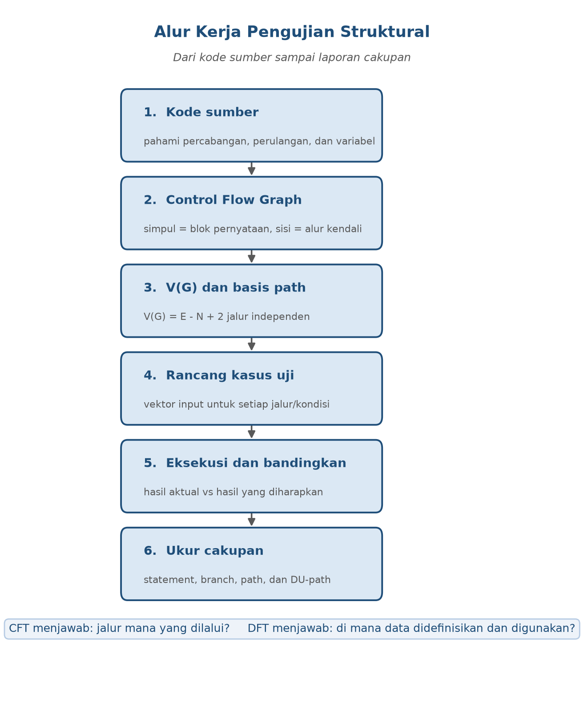
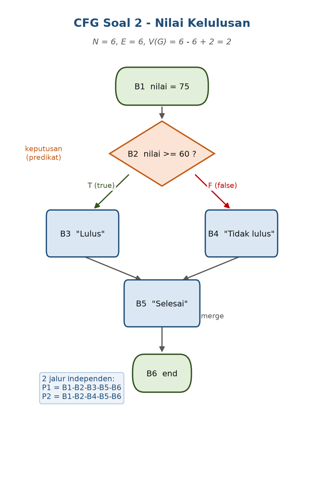
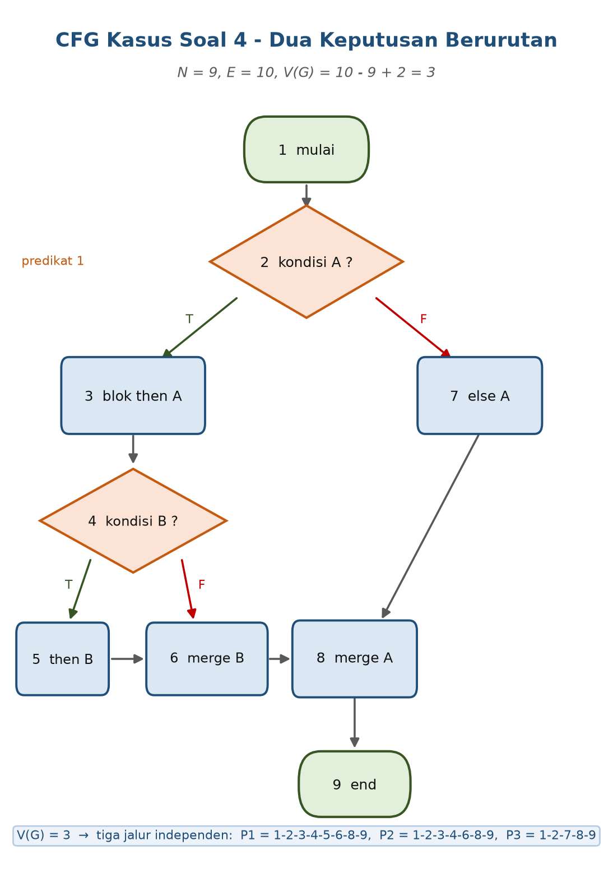
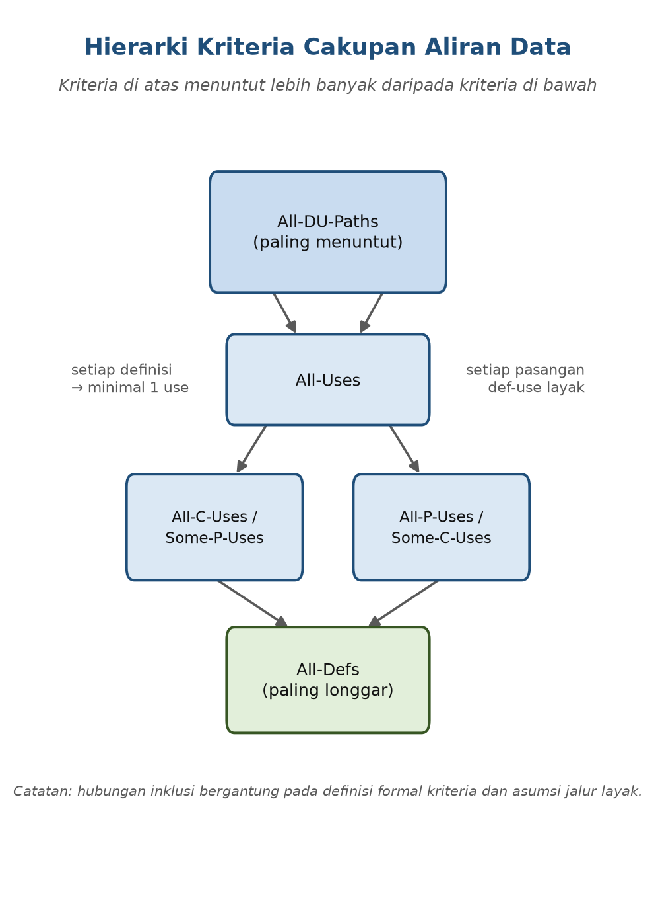
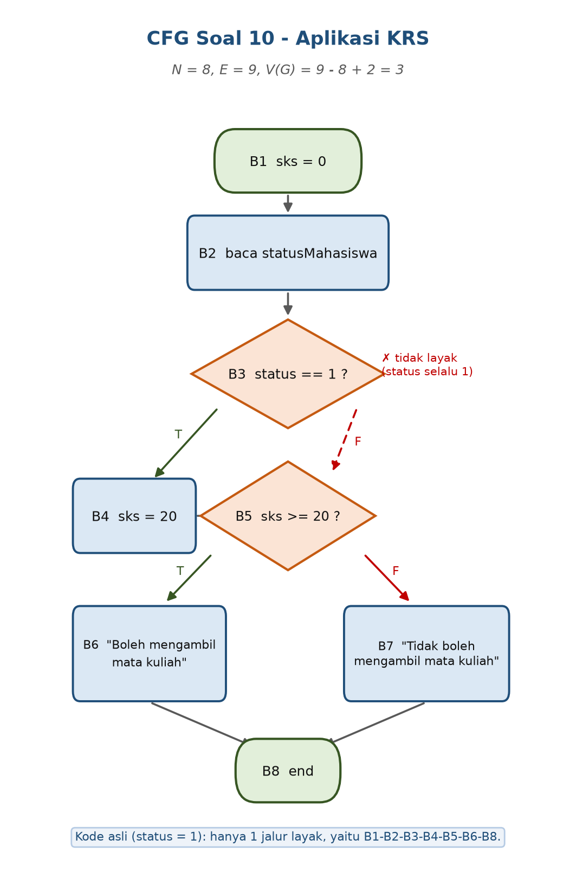
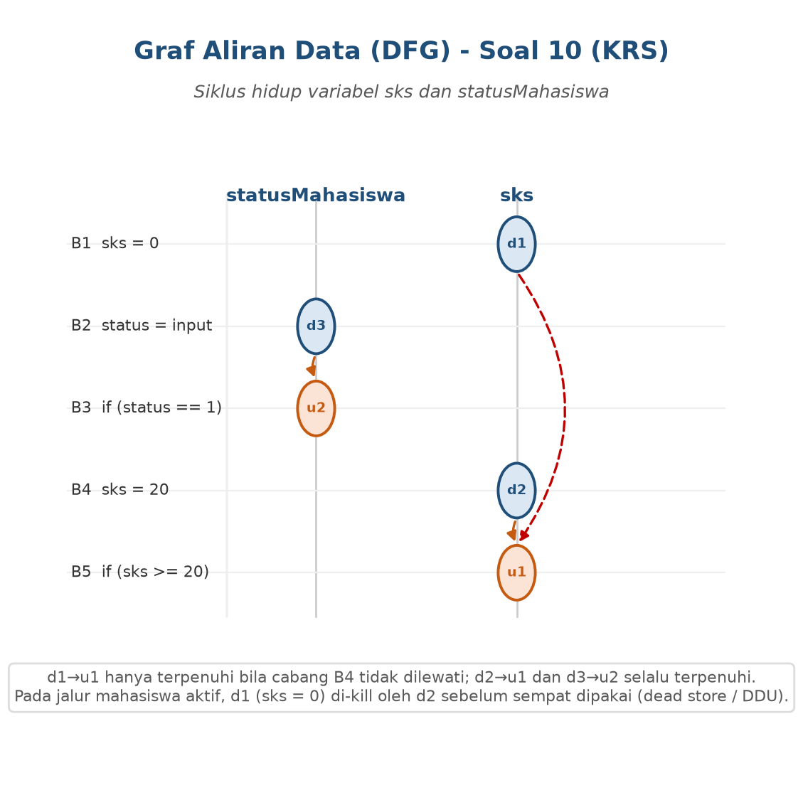

# A. Pendahuluan dan Cara Kerja

## A.1 Tujuan dan ruang lingkup tugas

Tugas ini menjawab sepuluh soal esai pada Bab 4 mata kuliah Software Quality Assurance (SQA) tentang **Software Structural Testing**, yaitu pengujian perangkat lunak yang memeriksa struktur internal program: alur kendali (control flow) dan aliran data (data flow). Setiap jawaban tidak hanya berisi penjelasan konsep, tetapi juga:

1. analisis grafik aliran kendali (Control Flow Graph/CFG) dan perhitungan kompleksitas siklomatis V(G);
2. daftar jalur independen, jalur layak, dan jalur tak layak;
3. tabel kasus uji beserta hasil yang diharapkan dan hasil aktual;
4. pembuktian dengan program C++ yang benar-benar dikompilasi dan dijalankan;
5. verifikasi angka (V(G), cakupan, pasangan Definition-Use) memakai alat analisis Python yang disertakan.

Seluruh berkas kode, keluaran program, dan gambar berada di folder yang sama dengan dokumen ini sehingga setiap angka pada tabel dapat ditelusuri kembali ke eksekusi nyata.

## A.2 Ringkasan jawaban

| Soal | Pokok bahasan | Inti jawaban |
|---|---|---|
| 1 | Konsep structural testing | Menguji struktur internal (pernyataan, cabang, jalur, variabel), bukan hanya keluaran; tujuannya mengetahui bagian mana yang sudah/belum teruji |
| 2 | CFG sederhana | Satu titik keputusan `nilai >= 60`; dua jalur eksekusi; N=6, E=6, V(G)=2; input 75 dan 50 |
| 3 | Statement & branch coverage | Dengan nilai 80: 3/4 pernyataan (75%) dan 1/2 cabang (50%); tambah nilai 40 menjadi 100% |
| 4 | Kompleksitas siklomatis | V(G) = 10 - 9 + 2 = 3; tiga jalur independen; minimal tiga kasus uji basis path |
| 5 | Jalur tak layak | Syarat `x > 10` dan `x < 5` bertentangan; tidak ada input yang dapat menjalankan jalur tersebut |
| 6 | Eksekusi simbolik | Syarat cabang `totalBelanja >= 500000`; vektor input 750000/500000 (true) dan 499999/250000 (false) |
| 7 | Konsep DFT | Menelusuri definisi dan penggunaan variabel; menemukan use-before-def yang tidak terlihat pada CFG |
| 8 | Anomali aliran data | Keluaran 85; nilai 70 adalah dead store (DDU) karena ditimpa sebelum dibaca |
| 9 | All-Defs, All-Uses, All-DU-Paths | Tiga tingkat tuntutan cakupan data; contoh harga/diskon menghasilkan 4 definisi, 5 pasangan DU, dan 6 DU-path |
| 10 | Integrasi CFT & DFT | V(G)=3 tetapi kode asli hanya punya 1 jalur layak; setelah status menjadi input ada 2 jalur layak; DFT menemukan dead store `sks = 0` |

## A.3 Alur kerja pengerjaan

Pengerjaan setiap soal mengikuti alur yang sama agar hasilnya konsisten dan dapat diverifikasi ulang.



1. **Membaca kode sumber** dan menandai pernyataan, keputusan, serta variabel.
2. **Menyusun CFG**: setiap blok pernyataan menjadi simpul, setiap perpindahan kendali menjadi sisi berarah.
3. **Menghitung V(G)** dengan `E - N + 2` dan memeriksa konsistensinya dengan `P + 1` (P = jumlah predikat).
4. **Menentukan basis jalur independen** secara aljabar, bukan hanya dengan mengira-ngira.
5. **Merancang vektor input** untuk setiap jalur atau kondisi, termasuk nilai batas.
6. **Menjalankan program** dan membandingkan hasil aktual dengan hasil yang diharapkan.
7. **Mengukur cakupan** (statement, branch, path) dan melakukan analisis aliran data (def, p-use, c-use, DU-path).

## A.4 Perangkat dan struktur berkas

| Komponen | Keterangan |
|---|---|
| Kompiler | g++ 16.2.0 (MinGW-w64, mode `-std=c++17 -Wall -Wextra`) |
| Bahasa kode solusi | C++17, satu berkas per soal, tanpa dependensi eksternal |
| Alat analisis | Python 3.15: `cfg_engine.py` (CFG, V(G), basis jalur), `aliran_data.py` (DU-path), `verifikasi_tugas.py` (pemeriksaan otomatis) |
| Dokumen | `isi_tugas.md` (sumber tunggal) → `Tugas_Bab4_CFT_DFT.docx` dan `.pdf` melalui `md2docx.py` dan `md2pdf.py` |
| Bukti eksekusi | Folder `kode/hasil/` berisi keluaran setiap skenario dan `laporan_eksekusi.txt` |

Struktur folder:

```text
Tugas-Bab4-CFT-DFT/
├── dokumen/
│   ├── isi_tugas.md              sumber isi dokumen
│   ├── mdparse.py                parser markdown
│   ├── md2docx.py                pembangkit Word
│   ├── md2pdf.py                 pembangkit PDF
│   ├── buat_gambar.py            pembangkit CFG/DFG
│   ├── gambar/                   7 gambar PNG (200 dpi)
│   ├── Tugas_Bab4_CFT_DFT.docx
│   └── Tugas_Bab4_CFT_DFT.pdf
├── kode/
│   ├── soal02_nilai.cpp ... soal10_krs.cpp
│   ├── jalankan_semua.ps1        kompilasi + eksekusi + verifikasi
│   ├── alat/                     cfg_engine.py, aliran_data.py, verifikasi_tugas.py
│   ├── build/                    berkas executable
│   └── hasil/                    keluaran program + laporan
└── README.md
```

> Seluruh angka pada dokumen ini dihasilkan atau diperiksa ulang oleh `kode/alat/verifikasi_tugas.py`. Skrip tersebut berhenti dengan galat apabila ada satu saja angka yang tidak konsisten, sehingga dokumen dan kode tidak dapat “berbeda cerita”.

# B. Jawaban Sepuluh Soal

## Soal 1 — Konsep Dasar Structural Testing

### Pertanyaan

Jelaskan pengertian Software Structural Testing dan tujuan penerapannya; uraikan perbedaannya dengan hanya memeriksa keluaran program; berikan satu contoh pada aplikasi akademik.

### Jawaban

**Software Structural Testing** adalah pendekatan pengujian *white-box* yang menggunakan informasi tentang struktur internal program sebagai dasar merancang dan menilai pengujian. Yang diperiksa bukan hanya “apakah keluaran benar”, tetapi “bagian mana dari kode yang benar-benar dijalankan oleh kasus uji”. Struktur yang dimaksud meliputi pernyataan, keputusan dan cabang, perulangan, jalur eksekusi, serta definisi dan penggunaan variabel.

Tujuan penerapannya:

1. **Mengukur kelengkapan pengujian.** Mengetahui persentase pernyataan, cabang, jalur, atau pasangan definisi-penggunaan yang sudah tercakup.
2. **Menemukan bagian kode yang belum pernah diuji.** Kode yang tidak pernah dieksekusi tidak mungkin membuktikan kebenarannya; ia menyimpan risiko kesalahan tersembunyi.
3. **Menemukan kode mati atau tidak terjangkau.** Jalur yang secara struktural ada tetapi tidak mungkin dieksekusi (infeasible) merupakan indikasi kesalahan logika atau syarat yang saling bertentangan.
4. **Menemukan anomali data.** Variabel yang dipakai sebelum diberi nilai, nilai yang ditimpa tanpa pernah dibaca, atau nilai lama yang seharusnya sudah diperbarui.
5. **Menjadi dasar perkiraan usaha pengujian.** Kompleksitas siklomatis memberi gambaran jumlah jalur independen yang perlu diuji.

**Perbedaan dengan pengujian yang hanya memeriksa keluaran.** Pengujian berbasis keluaran (black-box) menilai kesesuaian input dan output terhadap spesifikasi. Pengujian struktural menilai apakah struktur internal telah diuji secara memadai. Keduanya menjawab pertanyaan berbeda:

| Aspek | Hanya memeriksa keluaran | Memeriksa struktur internal |
|---|---|---|
| Dasar penilaian | kesesuaian input-output dengan spesifikasi | bagian kode yang dieksekusi dan hubungan antar-bagian |
| Pertanyaan utama | “Apakah hasilnya benar?” | “Apakah bagian yang relevan sudah diuji?” |
| Temuan khas | fungsi menghasilkan nilai salah | cabang tak teruji, kode mati, jalur tak layak, anomali data |
| Kekuatan | menguji perilaku dari sudut pengguna | mengukur kelengkapan dan menemukan cacat tersembunyi |
| Keterbatasan | tidak tahu bagian mana yang belum diuji | tidak menjamin kebutuhan pengguna sudah terpenuhi |
| Contoh alat | uji fungsional, pengujian antarmuka | instrumentasi cakupan, analisis CFG/DFG |

Keduanya bersifat komplementer: pengujian struktural memastikan “kode sudah diperiksa”, sedangkan pengujian fungsional memastikan “perilaku sesuai kebutuhan”.

**Contoh pada aplikasi akademik (pengisian KRS).** Misalkan alur pengisian KRS memiliki pemeriksaan berikut:

1. mahasiswa sudah login;
2. status mahasiswa aktif;
3. mata kuliah memiliki prasyarat dan prasyarat sudah lulus;
4. kuota kelas masih tersedia;
5. mata kuliah belum pernah diambil.

Jika penguji hanya mencoba satu skenario bahagia (login valid, mahasiswa aktif, prasyarat terpenuhi, kuota tersedia, belum pernah diambil), program akan mencetak “KRS berhasil disimpan”. Keluaran itu benar, tetapi belum membuktikan apa pun tentang jalur penolakan. Bila syarat kuota ditulis `if (kuota > 0)` alih-alih `if (kuota >= 1)`, atau bila pemeriksaan status memakai `!=` yang salah, kesalahan baru terlihat pada jalur yang tidak pernah diuji.

| Skenario | Jalur yang harus dilalui | Bila hanya uji “bahagia” |
|---|---|---|
| Mahasiswa aktif, semua syarat terpenuhi | 1-2-3-4-5-simpan | teruji |
| Mahasiswa tidak aktif | 1-2(tolak) | **belum teruji** |
| Prasyarat belum lulus | 1-2-3(tolak) | **belum teruji** |
| Kuota penuh | 1-2-3-4(tolak) | **belum teruji** |
| Mata kuliah sudah pernah diambil | 1-2-3-4-5(tolak) | **belum teruji** |

Dengan pengujian struktural, penguji menyadari bahwa empat dari lima jalur belum dijalankan, lalu merancang data uji untuk masing-masing. Inilah nilai utama structural testing: ia mengubah pertanyaan “apakah program berjalan benar untuk contoh ini?” menjadi “bagian mana dari program yang belum saya buktikan benar?”.

## Soal 2 — Control Flow Graph

### Pertanyaan

Perhatikan kode berikut, lalu (a) identifikasi titik keputusan, (b) jelaskan kemungkinan alur eksekusi, (c) gambarkan CFG sederhana, (d) tentukan input untuk menguji kedua cabang.

```cpp
int nilai = 75;

if (nilai >= 60) {
    cout << "Lulus";
} else {
    cout << "Tidak lulus";
}

cout << "Selesai";
```

### Jawaban

**a. Titik keputusan.** Titik keputusan (predikat) adalah pernyataan `if (nilai >= 60)` pada baris ketiga. Pernyataan ini memiliki dua hasil yang mungkin: **benar** (nilai lebih besar atau sama dengan 60) dan **salah** (nilai kurang dari 60). Tidak ada titik keputusan lain; `cout << "Selesai"` selalu dijalankan setelah percabangan selesai.

**b. Kemungkinan alur eksekusi.** Ada dua alur:

- **Jalur 1 (kondisi benar):** `nilai = 75` → evaluasi `nilai >= 60` (benar) → cetak `"Lulus"` → cetak `"Selesai"` → selesai.
- **Jalur 2 (kondisi salah):** `nilai = 75` → evaluasi `nilai >= 60` (salah) → cetak `"Tidak lulus"` → cetak `"Selesai"` → selesai.

Karena `nilai` diinisialisasi dengan 75 (konstan), eksekusi program apa adanya selalu melewati Jalur 1. Jalur 2 baru dapat diuji bila nilai dijadikan masukan (argumen program), seperti pada kode solusi `soal02_nilai.cpp`.

**c. Control Flow Graph.** Setiap blok pernyataan menjadi simpul dan setiap perpindahan kendali menjadi sisi berarah.



| Simpul | Isi |
|---|---|
| B1 | `nilai = 75` |
| B2 | `if (nilai >= 60)` |
| B3 | `cout << "Lulus"` |
| B4 | `cout << "Tidak lulus"` |
| B5 | `cout << "Selesai"` |
| B6 | akhir program |

| Sisi | Keterangan |
|---|---|
| B1 → B2 | alur masuk ke keputusan |
| B2 → B3 | cabang benar (true) |
| B2 → B4 | cabang salah (false) |
| B3 → B5 | penggabungan setelah blok then |
| B4 → B5 | penggabungan setelah blok else |
| B5 → B6 | keluar program |

Perhitungan: N = 6 simpul, E = 6 sisi, sehingga **V(G) = E - N + 2 = 6 - 6 + 2 = 2**. Hasil ini konsisten dengan `P + 1 = 1 + 1 = 2` (satu predikat). Dua jalur independen tersebut adalah:

- P1 = B1 → B2 → B3 → B5 → B6
- P2 = B1 → B2 → B4 → B5 → B6

**d. Input untuk menguji kedua cabang.** Satu nilai yang memenuhi `nilai >= 60` dan satu nilai yang memenuhi `nilai < 60`.

| Kasus uji | Input | Cabang | Hasil yang diharapkan |
|---|---|---|---|
| KU-01 | 75 (atau 60 sebagai nilai batas) | true | `Lulus` lalu `Selesai` |
| KU-02 | 50 | false | `Tidak lulus` lalu `Selesai` |

Nilai batas 60 sebaiknya ikut diuji karena kesalahan relasi (`>` alih-alih `>=`) hanya terdeteksi pada batas. Berikut keluaran program solusi untuk kedua vektor input.

[[AMBIL:../kode/hasil/soal02_input_75.txt]]

[[AMBIL:../kode/hasil/soal02_input_50.txt]]

Jejak `[JEJAK]` membuktikan bahwa kedua eksekusi memang menempuh jalur yang berbeda, sesuai dengan dua jalur pada CFG.

## Soal 3 — Statement Coverage dan Branch Coverage

### Pertanyaan

Pada kode berikut, penguji hanya menjalankan program dengan nilai 80. Tentukan (a) pernyataan yang dieksekusi, (b) apakah seluruh pernyataan tercakup, (c) apakah seluruh cabang diuji, (d) data uji tambahan yang diperlukan.

```cpp
int nilai = 80;

if (nilai >= 60) {
    cout << "Lulus";
} else {
    cout << "Tidak lulus";
}
```

### Jawaban

Kode tersebut memiliki empat pernyataan yang dapat dieksekusi:

| ID | Pernyataan |
|---|---|
| S1 | `int nilai = 80;` |
| S2 | `if (nilai >= 60)` (evaluasi kondisi) |
| S3 | `cout << "Lulus";` |
| S4 | `cout << "Tidak lulus";` |

**a. Pernyataan yang dieksekusi.** Dengan nilai 80: S1 (inisialisasi), S2 (kondisi dievaluasi dan bernilai benar), dan S3 (cetak “Lulus”). S4 tidak dieksekusi.

**b. Apakah seluruh pernyataan tercakup?** Belum. Tiga dari empat pernyataan dieksekusi, sehingga **statement coverage = 3/4 = 75%**. Pernyataan S4 pada blok `else` belum pernah dijalankan, sehingga kesalahan di dalamnya (misalnya salah ketik teks atau kesalahan logika) tidak akan terdeteksi.

**c. Apakah seluruh cabang diuji?** Belum. Keputusan S2 memiliki dua hasil: benar dan salah. Baru cabang benar yang tercakup, sehingga **branch coverage = 1/2 = 50%**. Branch coverage lebih kuat daripada statement coverage karena menuntut setiap hasil keputusan dijalankan minimal sekali.

**d. Data uji tambahan.** Diperlukan satu nilai yang membuat kondisi bernilai salah, yaitu `nilai < 60`. Nilai 40 adalah pilihan yang jelas; nilai 59 atau 60 juga penting untuk menguji batas.

| Kasus uji | Input | Pernyataan yang dieksekusi | Cabang | Cakupan kumulatif |
|---|---|---|---|---|
| KU-01 | 80 | S1, S2, S3 | true | 3/4 pernyataan; 1/2 cabang |
| KU-02 | 40 | S1, S2, S4 | false | 4/4 pernyataan; 2/2 cabang |

Program `soal03_coverage.cpp` melakukan instrumentasi manual: setiap pernyataan dan arah cabang dicatat, lalu persentase cakupan dihitung. Berikut keluarannya untuk skenario satu kasus uji dan dua kasus uji.

[[AMBIL:../kode/hasil/soal03_satu_kasus_80.txt]]

[[AMBIL:../kode/hasil/soal03_dua_kasus.txt]]

Keluaran tersebut menegaskan dua hal. Pertama, cakupan 75% dan 50% bukan berarti program “tiga perempat benar”, melainkan menandakan adanya bagian yang belum diuji. Kedua, satu kasus uji tambahan yang tepat (nilai 40) langsung menaikkan kedua ukuran menjadi 100%, jauh lebih efisien daripada menambah banyak kasus uji yang semuanya menempuh cabang yang sama.

## Soal 4 — Kompleksitas Siklomatis

### Pertanyaan

Jelaskan pengertian dan fungsi cyclomatic complexity. Sebuah CFG memiliki E = 10 sisi, N = 9 simpul, dan satu komponen terhubung. Hitung V(G) dengan `V(G) = E - N + 2`, lalu jelaskan maknanya dalam perencanaan pengujian.

### Jawaban

**Pengertian.** Kompleksitas siklomatis (cyclomatic complexity), diperkenalkan oleh Thomas McCabe, adalah ukuran struktural yang menyatakan **jumlah jalur independen** dalam sebuah grafik aliran kendali. Jalur independen adalah jalur yang memperkenalkan paling sedikit satu sisi baru yang belum terdapat pada kombinasi jalur independen yang sudah dipilih. Karena itu V(G) juga menyatakan jumlah minimum kasus uji yang diperlukan untuk basis path testing, yaitu pengujian yang memastikan setiap sisi pada CFG minimal dilalui satu kali.

**Fungsi pengukurannya:**

1. memperkirakan jumlah kasus uji untuk menguji seluruh jalur dasar;
2. mengukur kerumitan logika sebuah modul sehingga menjadi indikator risiko dan kemudahan pemeliharaan;
3. membantu memutuskan kapan sebuah fungsi perlu dipecah agar lebih sederhana;
4. memberi batas bawah usaha pengujian, bukan batas atas kualitas.

**Perhitungan.** Dengan E = 10, N = 9, dan graf terdiri atas satu komponen terhubung:

```text
V(G) = E - N + 2
     = 10 - 9 + 2
     = 3
```

Hasilnya **V(G) = 3**. Pemeriksaan silang: sebuah CFG dengan V(G) = 3 memiliki dua predikat, dan rumus alternatif `V(G) = P + 1 = 2 + 1 = 3` memberi hasil sama. Jumlah region (bidang tertutup ditambah bidang luar) juga 3. Ketiga cara tersebut konsisten; program `soal04_kompleksitas.cpp` memeriksa konsistensi ini secara otomatis.



**Makna dalam perencanaan pengujian.** Nilai V(G) = 3 berarti ada **tiga jalur independen** yang menjadi dasar pengujian, sehingga minimal tiga kasus uji perlu dirancang untuk basis path testing:

- P1 = 1 → 2 → 3 → 4 → 5 → 6 → 8 → 9 (kondisi A benar, kondisi B benar)
- P2 = 1 → 2 → 3 → 4 → 6 → 8 → 9 (kondisi A benar, kondisi B salah)
- P3 = 1 → 2 → 7 → 8 → 9 (kondisi A salah)

Implikasi praktisnya: tiga kasus uji tersebut menjamin setiap sisi CFG dilalui minimal satu kali. Namun V(G) bukan jaminan bahwa seluruh kombinasi kondisi sudah diuji. Bila dua keputusan tersebut sebenarnya independen, kombinasi lengkapnya ada empat (A benar/salah × B benar/salah); CFG di atas hanya memiliki tiga jalur karena keputusan B berada di dalam cabang A, sehingga kombinasi “A salah dan B benar” tidak mungkin secara struktur. Inilah sebabnya V(G) disebut jumlah jalur independen, bukan jumlah seluruh kombinasi kondisi.

Sebagai indikator risiko, McCabe memberikan panduan kasar berikut.

| Nilai V(G) | Tingkat kerumitan | Implikasi |
|---|---|---|
| 1 – 10 | sederhana | mudah diuji dan dipelihara |
| 11 – 20 | sedang | perlu perhatian pada perancangan kasus uji |
| 21 – 50 | kompleks | sulit diuji; kandidat refactoring |
| lebih dari 50 | sangat kompleks | praktis tidak dapat diuji menyeluruh; wajib dipecah |

[[AMBIL:../kode/hasil/soal04_kompleksitas.txt]]

## Soal 5 — Jalur Layak dan Jalur Tak Layak

### Pertanyaan

Perhatikan kode berikut. (a) Identifikasi kondisi agar `cout << "Proses A";` dijalankan. (b) Apakah ada nilai x yang memenuhi? (c) Jelaskan pengertian infeasible path. (d) Mengapa penguji perlu mengidentifikasi jalur tak layak sebelum merancang kasus uji?

```cpp
if (x > 10) {
    if (x < 5) {
        cout << "Proses A";
    }
}
```

### Jawaban

**a. Kondisi yang harus dipenuhi.** Untuk mencapai pernyataan `cout << "Proses A";`, eksekusi harus melewati dua keputusan dan keduanya harus bernilai benar:

```text
c1 : x > 10
c2 : x < 5
```

Jalur yang ditempuh adalah B1 → B2 (true) → B3 (true) → B4, dengan **path condition** `x > 10 DAN x < 5`.

**b. Apakah ada nilai x yang memenuhi?** Tidak ada. Secara logika, `x > 10` berarti x berada pada interval (10, +∞), sedangkan `x < 5` berarti x berada pada interval (-∞, 5). Irisan kedua interval tersebut adalah himpunan kosong:

```text
(10, +∞) ∩ (-∞, 5) = ∅
```

Tidak ada bilangan real (apalagi bilangan bulat) yang sekaligus lebih besar dari 10 dan lebih kecil dari 5. Dengan demikian pernyataan `cout << "Proses A";` tidak mungkin dieksekusi oleh input apa pun; ia adalah **kode yang tidak terjangkau** (unreachable code).

**c. Pengertian infeasible path.** Jalur tak layak (infeasible path) adalah jalur yang secara **struktural** tampak ada pada CFG — rangkaian simpul dan sisinya valid — tetapi **tidak dapat dieksekusi** karena gabungan syarat pada jalur tersebut bertentangan atau tidak dapat dipenuhi oleh domain input. Pada contoh ini, jalur B1-B2(true)-B3(true)-B4 ada pada grafik, tetapi syarat `x > 10` dan `x < 5` tidak konsisten sehingga jalur tersebut mustahil dilalui. Infeasible path berbeda dari jalur yang “belum diuji”: jalur yang belum diuji masih mungkin dijalankan, sedangkan jalur tak layak tidak akan pernah bisa.

**d. Mengapa perlu diidentifikasi lebih dahulu.** Ada empat alasan utama:

1. **Menghindari pekerjaan sia-sia.** Tanpa analisis, penguji dapat menghabiskan waktu mencari input yang sebenarnya tidak ada.
2. **Membedakan kode mati dari kode yang belum teruji.** Keduanya terlihat “belum tercakup” pada laporan cakupan, tetapi hanya yang kedua membutuhkan kasus uji baru.
3. **Menemukan kesalahan logika.** Kondisi yang bertentangan sering menandakan salah tulis, misalnya seharusnya `x > 10 && x > 5`, `x > 10 && x < 50`, atau penggunaan operator `&&`/`||` yang keliru.
4. **Membuat target cakupan realistis.** Bila jalur tak layak dihitung, target 100% path coverage menjadi mustahil; penguji harus mendokumentasikan pengecualian beserta alasannya agar laporan cakupan tidak menyesatkan.

| Jalur | Syarat | Status | Keterangan |
|---|---|---|---|
| B1-B2(false)-B4 | x ≤ 10 | layak | misalnya x = 0 |
| B1-B2(true)-B3(false)-B4 | x > 10 dan x ≥ 5 | layak | misalnya x = 15 |
| B1-B2(true)-B3(true)-B4 | x > 10 dan x < 5 | **tidak layak** | irisan kosong |

Program `soal05_infeasible.cpp` membuktikan hal ini dengan dua cara: analisis interval secara simbolik dan penyisiran satu juta nilai x. Berikut keluarannya.

[[AMBIL:../kode/hasil/soal05_infeasible.txt]]

## Soal 6 — Eksekusi Simbolik dan Pemilihan Input

### Pertanyaan

Pada kode pemberian diskon berikut, (a) identifikasi kondisi penentu jalur, (b) tentukan input untuk masing-masing cabang, (c) jelaskan bagaimana analisis kondisi membantu memilih input secara terarah, (d) mengapa pemilihan input acak belum tentu mencakup seluruh cabang.

```cpp
if (totalBelanja >= 500000) {
    cout << "Diskon diberikan";
} else {
    cout << "Tidak mendapat diskon";
}
```

### Jawaban

**a. Kondisi penentu jalur.** Satu-satunya kondisi adalah `totalBelanja >= 500000`. Kondisi ini menentukan dua jalur:

- cabang benar: `totalBelanja >= 500000` → cetak “Diskon diberikan”;
- cabang salah: `totalBelanja < 500000` → cetak “Tidak mendapat diskon”.

**b. Nilai input untuk masing-masing cabang.** Nilai dipilih berdasarkan penyelesaian kondisi, bukan coba-coba.

| Kasus uji | totalBelanja | Evaluasi kondisi | Cabang | Hasil yang diharapkan |
|---|---|---|---|---|
| KU-01 | 750000 | 750000 >= 500000 → benar | true | Diskon diberikan |
| KU-02 | 500000 | tepat di batas → benar | true | Diskon diberikan |
| KU-03 | 499999 | satu di bawah batas → salah | false | Tidak mendapat diskon |
| KU-04 | 250000 | jauh di bawah batas → salah | false | Tidak mendapat diskon |

**c. Peran analisis kondisi (symbolic execution).** Alih-alih langsung memilih angka, penguji memperlakukan `totalBelanja` sebagai simbol T dan menurunkan *path condition*:

```text
Jalur true :  PC1 = (T >= 500000)
Jalur false:  PC2 = not (T >= 500000) = (T < 500000)
```

Penyelesaian PC1 dan PC2 menghasilkan daerah input yang valid. Penguji lalu memilih satu wakil dari setiap daerah, ditambah nilai batas (500000 dan 499999) dan nilai ekstrem (0) untuk menguji ketepatan operator. Cara ini disebut **eksekusi simbolik**: program dianalisis dengan ekspresi simbolik, kemudian sebuah *constraint solver* atau penalaran manual mencari nilai konkret yang memenuhi ekspresi tersebut.

Keuntungannya: input dijamin **mencapai jalur yang dituju**, bukan kebetulan. Untuk program dengan banyak kondisi gabungan (misalnya `if (umur >= 17 && saldo >= 100000 && status == "aktif")`), penalaran simbolik memecah syarat menjadi kendala per variabel sehingga jauh lebih efisien daripada mencoba kombinasi secara acak.

**d. Mengapa input acak belum tentu mencakup seluruh cabang.** Pemilihan acak tidak memiliki jaminan cakupan:

1. **Distribusi tidak diketahui.** Bila rentang nilai yang realistis sangat lebar, peluang mengenai daerah sempit (misalnya `totalBelanja` antara 499000 dan 501000) sangat kecil.
2. **Cabang jarang.** Kondisi seperti `if (totalBelanja == 0)` atau `if (status == 7)` hampir tidak mungkin tercapai secara acak.
3. **Nilai batas terlewat.** Kesalahan operator `>` versus `>=` hanya muncul pada nilai tepat di batas; input acak hampir selalu menghasilkan nilai jauh dari batas.
4. **Input acak tidak dapat direproduksi.** Tanpa seed dan strategi yang jelas, pengujian sulit diulang dan diaudit.

Karena itu pengujian struktural menggabungkan analisis kondisi (untuk memastikan cabang tercapai) dengan analisis nilai batas (untuk menguji ketepatan perbandingan). Berikut keluaran program solusi untuk tabel kasus uji di atas.

[[AMBIL:../kode/hasil/soal06_tabel_batas.txt]]

## Soal 7 — Konsep Dasar Data Flow Testing

### Pertanyaan

Jelaskan pengertian Data Flow Testing dan perbedaannya dengan Control Flow Testing. Gunakan contoh aplikasi penghitungan nilai mahasiswa untuk menunjukkan masalah penggunaan variabel yang tidak terlihat dari pemeriksaan jalur kontrol.

### Jawaban

**Pengertian.** Data Flow Testing (DFT) adalah pengujian struktural yang memusatkan perhatian pada **siklus hidup variabel**: kapan variabel didefinisikan (def), kapan nilainya digunakan (use), dan bagaimana nilainya berubah di sepanjang eksekusi. DFT menelusuri pasangan **Definition-Use (DU)** — yaitu pasangan tempat sebuah variabel diberi nilai dan tempat nilai itu dibaca — serta memastikan setiap pasangan yang layak benar-benar diuji.

Dalam DFT dikenal dua jenis penggunaan:

- **p-use (predicate use):** variabel digunakan untuk menentukan keputusan, misalnya `if (nilai >= 60)`.
- **c-use (computation use):** variabel digunakan dalam perhitungan atau keluaran, misalnya `total = nilai + 10` atau `cout << nilai`.

**Perbedaan dengan CFT.**

| Aspek | Control Flow Testing | Data Flow Testing |
|---|---|---|
| Fokus | urutan eksekusi, percabangan, perulangan | definisi, penggunaan, dan perubahan nilai variabel |
| Objek | simpul, sisi, jalur, predikat | def, p-use, c-use, DU-path |
| Kriteria khas | statement, branch, path coverage, V(G) | All-Defs, All-Uses, All-DU-Paths |
| Pertanyaan | “jalur mana yang dijalankan?” | “di mana nilai ini dibuat dan dipakai?” |
| Cacat yang dibantu deteksi | cabang tak teruji, jalur tak layak | use-before-def, dead store, nilai basi |

**Contoh pada aplikasi penghitungan nilai.** Perhatikan kode berikut.

```cpp
int nilai;                      // deklarasi, belum ada nilai
bool remedial = false;

if (skorTugas < 60) {           // p-use: skorTugas
    nilai = 55;                 // definisi: nilai
    remedial = true;            // definisi: remedial
}

cout << nilai;                  // c-use: nilai
if (remedial) {                 // p-use: remedial
    cout << "Remedial";
}
```

Dari sudut **alur kendali**, kode ini memiliki dua jalur yang keduanya sah: (1) masuk blok `if` lalu mencetak nilai, dan (2) melewati blok `if` lalu mencetak nilai. Keduanya lolos pemeriksaan CFG karena tidak ada cabang yang “salah”.

Dari sudut **aliran data**, jalur kedua mengandung cacat serius: ketika `skorTugas >= 60`, blok `if` tidak dijalankan sehingga variabel `nilai` **belum pernah didefinisikan** saat `cout << nilai` membaca nilainya. Ini adalah anomali **use-before-def**. Pada C++ variabel lokal tanpa inisialisasi memiliki nilai tak tentu; membacanya adalah perilaku tidak terdefinisi (undefined behavior), sehingga program dapat mencetak angka sampah.

| Jalur | skorTugas | Peristiwa data | Temuan |
|---|---|---|---|
| P1 | 50 | def(nilai), def(remedial), use(nilai), use(remedial) | normal |
| P2 | 80 | use(nilai) tanpa def, use(remedial) | **use-before-def pada `nilai`** |

Contoh ini memperlihatkan keterbatasan CFT: memastikan “semua baris pernah dieksekusi” tidak menjamin “semua variabel bernilai valid saat dibaca”. DFT melengkapi CFT dengan menelusuri hubungan definisi-penggunaan, sehingga cacat seperti penggunaan sebelum definisi, definisi yang tidak pernah dipakai, dan nilai yang seharusnya diperbarui tetapi masih memakai nilai lama dapat ditemukan.

## Soal 8 — Anomali Aliran Data

### Pertanyaan

Perhatikan kode berikut. (a) Jelaskan kapan `nilai` didefinisikan dan digunakan. (b) Nilai berapa yang ditampilkan? (c) Apa yang terjadi pada nilai 70? (d) Bagaimana DFT membantu menemukan penugasan yang tidak digunakan?

```cpp
int nilai;

nilai = 70;
nilai = 85;

cout << nilai;
```

### Jawaban

**a. Kapan variabel didefinisikan dan digunakan.**

| Urutan | Baris | Peristiwa | Keterangan |
|---|---|---|---|
| 1 | `int nilai;` | deklarasi | ruang dibuat, tetapi **belum ada definisi bernilai** |
| 2 | `nilai = 70;` | definisi d1 | nilai 70 ditetapkan |
| 3 | `nilai = 85;` | definisi d2 | nilai 85 ditetapkan; d1 ditimpa (di-*kill*) |
| 4 | `cout << nilai;` | penggunaan u1 (c-use) | membaca definisi terakhir yang masih hidup, yaitu d2 |

**b. Nilai yang ditampilkan.** Program menampilkan **85**, karena `cout` membaca nilai terakhir yang diberikan sebelum pernyataan tersebut, yaitu hasil definisi d2. Nilai 70 sudah tidak berlaku.

**c. Apa yang terjadi pada nilai 70.** Nilai 70 merupakan **dead assignment** (penugasan mati): nilainya ditetapkan, tetapi langsung ditimpa oleh `nilai = 85` sebelum sempat dibaca. Dalam istilah anomali aliran data, pola ini disebut **DDU (Definition-Definition-Use)** atau *definition without use*. Penugasan tersebut tidak memengaruhi keluaran sama sekali; ia hanya membuang satu operasi dan, yang lebih penting, sering menandakan kesalahan logika—misalnya programmer bermaksud memakai 70 untuk perhitungan lain tetapi lupa, atau urutan penugasan tertukar.

**d. Bagaimana DFT menemukan penugasan yang tidak digunakan.** DFT membentuk pasangan definisi-penggunaan dengan melacak definisi mana yang **mencapai** setiap penggunaan (*reaching definitions*):

- Pasangan yang sah: **(d2, u1)** — definisi 85 mencapai `cout`.
- Pasangan (d1, u1) **tidak ada**, sebab d1 sudah di-*kill* oleh d2 sebelum u1.
- Karena d1 tidak muncul pada pasangan mana pun, d1 teridentifikasi sebagai *def-without-use*.

Pada kriteria **All-Defs**, setiap definisi wajib mencapai minimal satu penggunaan. Definisi d1 gagal memenuhi kewajiban ini, sehingga alat analisis melaporkan pelanggaran. Alat `aliran_data.py` pada folder kode melakukan analisis ini secara otomatis: ia menelusuri jalur, mencatat definisi terakhir setiap variabel, membentuk pasangan DU, lalu mendaftar definisi yang tidak pernah terpakai. Berikut hasilnya.

[[AMBIL:../kode/hasil/soal08_aliran_data.txt]]

Perlu dicatat bahwa kompiler modern juga dapat memberikan peringatan untuk kasus seperti ini (misalnya `-Wunused-but-set-variable`), tetapi peringatan kompiler bersifat lokal dan bergantung pada opsi; DFT memberikan dasar yang lebih sistematis karena analisisnya dilakukan terhadap struktur program dan pasangan definisi-penggunaan, bukan sekadar pola teks.

## Soal 9 — Kriteria All-Defs, All-Uses, dan All-DU-Paths

### Pertanyaan

Jelaskan perbedaan All-Defs, All-Uses, dan All-DU-Paths. Berikan contoh sederhana penggunaan sebuah variabel dan jelaskan bagaimana ketiga kriteria menghasilkan tuntutan pengujian yang berbeda.

### Jawaban

**Pengertian ketiga kriteria.**

1. **All-Defs.** Setiap definisi variabel yang relevan harus mencapai **paling sedikit satu** penggunaan. Kriteria ini paling longgar: cukup satu penggunaan per definisi, tidak peduli penggunaan mana.
2. **All-Uses.** Setiap **pasangan definisi-penggunaan** yang layak harus dicakup. Bila satu definisi memiliki dua penggunaan berbeda, keduanya harus dijalankan. Karena itu All-Uses lebih kuat daripada All-Defs.
3. **All-DU-Paths.** Setiap **jalur layak** dari suatu definisi menuju suatu penggunaan harus dicakup, tanpa definisi ulang variabel di tengah jalur (*definition-clear path*). Bila ada dua jalur berbeda dari definisi yang sama menuju penggunaan yang sama, keduanya harus diuji. Kriteria ini paling kuat.



**Contoh 1 — percabangan sederhana.** Perhatikan kode berikut (contoh 1 pada `soal09_kriteria.cpp`).

```cpp
int harga = <input>;          // d1(harga)
int diskon = 0;               // d2(diskon)

if (harga > 50000) {          // u1(p-use harga)
    diskon = 10;              // d3(diskon), mematikan d2
}

int total = harga - diskon;   // u2(c-use harga), u3(c-use diskon), d4(total)
cout << total;                // u4(c-use total)
```

Tabel peristiwa data:

| Definisi | Lokasi | Penggunaan yang mungkin | Jenis |
|---|---|---|---|
| d1 | `harga = <input>` | u1 (`harga > 50000`), u2 (`total = harga - diskon`) | p-use, c-use |
| d2 | `diskon = 0` | u3 (`total = ... - diskon`) hanya bila cabang if **salah** | c-use |
| d3 | `diskon = 10` | u3 hanya bila cabang if **benar** | c-use |
| d4 | `total = harga - diskon` | u4 (`cout << total`) | c-use |

Pasangan DU dan jalurnya:

| Pasangan | Variabel | Jalur | Jumlah DU-path |
|---|---|---|---|
| d1 → u1 | harga | langsung ke kondisi | 1 |
| d1 → u2 | harga | melalui cabang benar atau salah | 2 |
| d2 → u3 | diskon | hanya cabang salah | 1 |
| d3 → u3 | diskon | hanya cabang benar | 1 |
| d4 → u4 | total | setelah perhitungan | 1 |
| **Total** | | | **6 DU-path, 5 pasangan** |

Tuntutan setiap kriteria:

| Kriteria | Target yang harus dicakup | Bila hanya memakai satu kasus uji (harga = 100000) |
|---|---|---|
| All-Defs | 4 definisi (d1, d2, d3, d4) masing-masing minimal satu use | 3/4 — d2 tidak pernah dipakai karena di-kill d3 |
| All-Uses | 5 pasangan DU | 4/5 — pasangan d2→u3 belum tercakup |
| All-DU-Paths | 6 jalur definisi-penggunaan | 4/6 |

Dengan dua kasus uji, seluruh target terpenuhi:

| Kasus uji | harga | Cabang | diskon | total | Pasangan/DU-path yang tercakup |
|---|---|---|---|---|---|
| KU-01 | 100000 | benar | 10 | 99990 | d1→u1, d1→u2 (jalur benar), d3→u3, d4→u4 |
| KU-02 | 30000 | salah | 0 | 30000 | d1→u1, d1→u2 (jalur salah), d2→u3, d4→u4 |

Perhatikan bahwa **jumlah kasus uji yang diperlukan bisa sama** (dua kasus), tetapi **kewajiban yang harus dibuktikan berbeda**: All-Defs hanya menuntut empat definisi “pernah dipakai”, All-Uses menuntut lima pasangan, dan All-DU-Paths menuntut enam jalur. Perbedaan ini menjadi penting ketika program makin kompleks: jumlah jalur dapat tumbuh jauh lebih cepat daripada jumlah pasangan.

**Contoh 2 — perulangan.** Efek terbesar All-DU-Paths muncul pada perulangan. Perhatikan kode berikut.

```cpp
int i = 0;
int total = 0;

while (i < 3) {
    if (kondisi) {
        total = total + i;    // definisi total di dalam loop
    }
    i++;
}

cout << total;                // penggunaan total setelah loop
```

Definisi `total` di dalam loop dapat menjadi definisi terakhir pada iterasi ke-1, ke-2, atau ke-3, bergantung pada kapan `kondisi` terakhir bernilai benar. Masing-masing menghasilkan jalur definisi-penggunaan yang berbeda panjangnya: dari definisi pada iterasi ke-1, eksekusi masih melewati dua iterasi berikutnya; dari iterasi ke-2 melewati satu iterasi; dari iterasi ke-3 langsung keluar loop. Untuk tiga iterasi saja sudah ada tiga DU-path berbeda untuk pasangan “definisi total → cout total”. Bila batas perulangan adalah n, jumlah jalur dapat tumbuh sebanding n, dan untuk loop tak terbatas secara teori dapat tumbuh tanpa batas. Inilah sebabnya All-DU-Paths sering tidak praktis dicapai 100%, sedangkan All-Uses masih realistis.

**Kesimpulan perbandingan.**

| Kriteria | Kekuatan | Kelemahan | Cocok dipakai saat |
|---|---|---|---|
| All-Defs | paling murah, cepat dicapai | tidak menjamin penggunaan penting diuji | pengujian awal, kode besar, waktu terbatas |
| All-Uses | menutup seluruh interaksi definisi-penggunaan | jumlah target tumbuh dengan banyaknya use | pengujian modul dengan banyak variabel |
| All-DU-Paths | paling menyeluruh, menemukan cacat jalur data | jumlah jalur dapat meledak, banyak jalur tak layak | modul kritis, algoritma perhitungan |

## Soal 10 — Studi Kasus Integrasi CFT dan DFT

### Pertanyaan

Pada kode aplikasi KRS berikut (`statusMahasiswa == 1` berarti aktif, `0` berarti tidak aktif), jawab: (a) alur saat mahasiswa aktif, (b) alur saat tidak aktif, (c) variabel yang terlibat beserta definisi dan penggunaannya, (d) rancang kasus uji untuk kedua kondisi, (e) bagaimana CFT dan DFT digunakan bersama, (f) apakah pengujian kedua kondisi cukup membuktikan seluruh kebutuhan aplikasi KRS terpenuhi?

```cpp
int sks = 0;
int statusMahasiswa = 1;

if (statusMahasiswa == 1) {
    sks = 20;
}

if (sks >= 20) {
    cout << "Boleh mengambil mata kuliah";
} else {
    cout << "Tidak boleh mengambil mata kuliah";
}
```

### Jawaban

**a. Alur eksekusi saat mahasiswa aktif.** Dengan `statusMahasiswa = 1`, eksekusi berjalan: B1 (`sks = 0`) → B2 (baca/inisialisasi status) → B3 (kondisi `status == 1` **benar**) → B4 (`sks = 20`) → B5 (kondisi `sks >= 20` **benar**) → B6 (cetak “Boleh mengambil mata kuliah”) → B8 (selesai). Program mencetak **“Boleh mengambil mata kuliah”**.

**b. Alur eksekusi saat mahasiswa tidak aktif.** Bila `statusMahasiswa = 0`: B1 (`sks = 0`) → B2 → B3 (kondisi **salah**) → B5 (kondisi `sks >= 20` **salah**, karena sks masih 0) → B7 (cetak “Tidak boleh mengambil mata kuliah”) → B8. Program mencetak **“Tidak boleh mengambil mata kuliah”**.

Ada catatan penting: pada kode **asli**, `statusMahasiswa` dideklarasikan dengan nilai tetap 1. Akibatnya cabang salah pada B3 **tidak mungkin dieksekusi**. Agar alur (b) dapat diuji, nilai `statusMahasiswa` harus dijadikan parameter atau masukan. Program solusi `soal10_krs.cpp` menyediakan dua mode: mode asli (konstan 1) dan mode parametrik (status dari argumen). Ini sendiri merupakan temuan pengujian: kode yang tidak dapat dikonfigurasi menjadi tidak dapat diuji.

**c. Variabel, definisi, dan penggunaan.**

| Variabel | Definisi | Penggunaan | Jenis |
|---|---|---|---|
| `sks` | B1 (`sks = 0`), B4 (`sks = 20`) | B5 (`if (sks >= 20)`) | p-use |
| `statusMahasiswa` | B2 (inisialisasi/input) | B3 (`if (statusMahasiswa == 1)`) | p-use |

Pasangan DU:

| Pasangan | Variabel | Kapan tercapai | Catatan |
|---|---|---|---|
| B2 → B3 | statusMahasiswa | selalu | satu-satunya definisi dan penggunaan |
| B4 → B5 | sks | jalur mahasiswa aktif | nilai 20 digunakan pada kondisi |
| B1 → B5 | sks | hanya jalur mahasiswa tidak aktif | pada jalur aktif, definisi B1 di-kill B4 |

Temuan DFT penting: pada jalur mahasiswa aktif, `sks = 0` (B1) **tidak pernah dibaca** karena langsung ditimpa `sks = 20` (B4). Ini adalah dead store lokal (pola DDU). Secara global definisi B1 tetap memiliki penggunaan pada jalur tidak aktif, sehingga All-Defs dapat terpenuhi bila kedua jalur diuji; tetapi pada jalur aktif, inisialisasi tersebut mubazir dan dapat menutupi kesalahan logika bila nilai awal seharusnya dipakai (misalnya bila `sks` semestinya berisi SKS yang sudah ditempuh, bukan 0).



Perhitungan CFG: N = 8, E = 9, sehingga **V(G) = 9 - 8 + 2 = 3**. Ada empat jalur sederhana pada grafik:

1. B1-B2-B3-B4-B5-B6-B8 (aktif, sks = 20) → **layak**
2. B1-B2-B3-B4-B5-B7-B8 (aktif, tetapi sks < 20) → tidak layak, karena setelah B4 sks = 20
3. B1-B2-B3-B5-B6-B8 (tidak aktif, tetapi sks >= 20) → tidak layak, karena sks = 0
4. B1-B2-B3-B5-B7-B8 (tidak aktif, sks = 0) → tidak layak **pada kode asli** (status selalu 1), layak setelah status menjadi input

Jadi V(G) = 3 tetapi pada kode asli hanya **satu** jalur yang layak. Ini contoh nyata bahwa V(G) adalah batas atas, bukan jumlah jalur yang benar-benar dapat diuji. Setelah `statusMahasiswa` dijadikan input, jalur 1 dan 4 menjadi layak, sedangkan jalur 2 dan 3 tetap tidak layak karena logika `sks` tidak memungkinkan kombinasi tersebut.



**d. Rancangan kasus uji.** Karena kode asli tidak dapat mencapai cabang tidak aktif, kasus uji dirancang untuk versi parametrik. Hasil aktual diambil dari eksekusi `soal10_krs.exe`.

| Kasus uji | statusMahasiswa | sks setelah B4/B3 | Jalur | Hasil yang diharapkan | Hasil aktual | Status |
|---|---|---|---|---|---|---|
| TC-01 | 1 (aktif) | 20 | B1-B2-B3-B4-B5-B6-B8 | Boleh mengambil mata kuliah | Boleh mengambil mata kuliah | sesuai |
| TC-02 | 0 (tidak aktif) | 0 | B1-B2-B3-B5-B7-B8 | Tidak boleh mengambil mata kuliah | Tidak boleh mengambil mata kuliah | sesuai |
| TC-03 | 2 (nilai tidak valid) | 0 | B1-B2-B3-B5-B7-B8 | Tidak boleh mengambil mata kuliah | Tidak boleh mengambil mata kuliah | sesuai, tetapi perlu validasi input |

TC-03 dimasukkan sebagai uji nilai tidak valid: kode memperlakukan semua nilai selain 1 sebagai “tidak aktif”, termasuk nilai yang tidak sah. Ini bukan kesalahan keluaran, melainkan **keterbatasan validasi**: status 2 atau -1 seharusnya ditolak secara eksplisit, bukan dipetakan diam-diam ke “tidak aktif”. Temuan seperti ini muncul dari pengujian nilai batas/kelas ekivalensi, bukan dari cakupan struktural semata.

[[AMBIL:../kode/hasil/soal10_asli.txt]]

[[AMBIL:../kode/hasil/soal10_status_0.txt]]

**e. Bagaimana CFT dan DFT digunakan bersama.** Keduanya dipakai secara berurutan dan saling melengkapi:

1. **CFT menyusun peta jalur.** CFG menghasilkan tiga jalur independen dan menunjukkan bahwa dua di antaranya tidak layak. Penguji memakai informasi ini untuk memutuskan bahwa kode perlu di-*refactor* (status dijadikan input) sebelum pengujian cabang dapat dilakukan.
2. **CFT merancang kasus uji per cabang.** Setelah refactoring, TC-01 dan TC-02 menjamin kedua cabang B3 dan kedua cabang B5 tercakup.
3. **DFT memeriksa data di setiap jalur.** Analisis DU menunjukkan pasangan B2→B3, B4→B5, dan B1→B5; DFT juga menemukan bahwa B1→B5 hanya terjadi pada jalur tidak aktif dan bahwa `sks = 0` adalah dead store pada jalur aktif.
4. **DFT menilai kualitas nilai.** DFT memunculkan pertanyaan yang tidak dijawab CFT: apakah `sks = 0` memang nilai awal yang benar? Apakah `sks` seharusnya berisi SKS yang sudah ditempuh? Apakah batas 20 sesuai aturan akademik? Pertanyaan-pertanyaan ini mengarah pada verifikasi kebutuhan, bukan sekadar struktur kode.
5. **Hasilnya digabungkan dalam laporan cakupan.** CFT memberi angka statement/branch coverage; DFT memberi angka All-Defs/All-Uses/All-DU-Paths. Keduanya dilaporkan bersama agar gambaran kelengkapan pengujian tidak berat sebelah.

**f. Apakah pengujian kedua kondisi cukup membuktikan seluruh kebutuhan KRS terpenuhi?** Tidak. Ada beberapa alasan:

1. **Kode yang diuji hanyalah potongan kecil.** Aplikasi KRS sesungguhnya melibatkan login, validasi prasyarat, kuota kelas, bentrok jadwal, batas maksimum SKS berdasarkan IPS, status pembayaran, dan penyimpanan basis data. Menguji dua cabang pada potongan kode ini tidak menyentuh kebutuhan tersebut.
2. **Cakupan struktural bukan jaminan kebenaran fungsional.** Dua kasus uji mencapai 100% branch coverage pada potongan kode, tetapi aturan bisnis bisa tetap salah. Contohnya, batas `sks >= 20` mungkin seharusnya bergantung pada IPS: 24 SKS untuk IPS ≥ 3,00 dan 20 SKS untuk IPS < 3,00. Kode yang ada tidak memodelkan aturan itu sama sekali, sehingga cakupan 100% tidak akan menemukannya.
3. **Nilai tidak valid tidak ditangani.** Seperti terlihat pada TC-03, status selain 0/1 diperlakukan sebagai “tidak aktif” tanpa pesan kesalahan. Dari sudut kebutuhan, ini bisa jadi cacat validasi.
4. **Aspek non-fungsional tidak diuji.** Keamanan (otorisasi mahasiswa hanya dapat mengubah KRS miliknya), kinerja saat masa pengisian KRS bersamaan, ketahanan terhadap input tidak wajar, serta integritas data saat terjadi kegagalan penyimpanan tidak tercakup oleh CFT maupun DFT pada potongan kode ini.
5. **Keterlacakan kebutuhan tidak ada.** Pengujian struktural berangkat dari kode, bukan dari spesifikasi. Tanpa matriks keterlacakan kebutuhan–kasus uji, tidak ada bukti bahwa setiap kebutuhan telah diuji.

Kesimpulannya, CFT dan DFT menjawab pertanyaan “apakah struktur kode sudah diuji memadai”, bukan “apakah perangkat lunak memenuhi seluruh kebutuhan”. Keduanya harus menjadi bagian dari strategi SQA yang lebih luas: analisis kebutuhan, pengujian fungsional berbasis spesifikasi, pengujian integrasi, pengujian keamanan, dan pengujian kinerja.

# C. Hasil Eksekusi dan Verifikasi

## C.1 Kompilasi dan eksekusi program

Seluruh program dikompilasi dengan `g++ -std=c++17 -Wall -Wextra -O0` dan dijalankan melalui `kode/jalankan_semua.ps1`. Tidak ada peringatan kompiler pada kedelapan berkas.

| Program | Skenario yang dijalankan | Berkas keluaran |
|---|---|---|
| `soal02_nilai.cpp` | input 75 dan 50 | `soal02_input_75.txt`, `soal02_input_50.txt` |
| `soal03_coverage.cpp` | satu kasus (80); dua kasus (80, 40) | `soal03_satu_kasus_80.txt`, `soal03_dua_kasus.txt` |
| `soal04_kompleksitas.cpp` | tiga CFG (soal 4, soal 2, soal 10) | `soal04_kompleksitas.txt` |
| `soal05_infeasible.cpp` | analisis simbolik + sisir satu juta nilai | `soal05_infeasible.txt` |
| `soal06_diskon.cpp` | tabel nilai batas | `soal06_tabel_batas.txt` |
| `soal08_aliran_data.cpp` | jejak definisi/penggunaan | `soal08_aliran_data.txt` |
| `soal09_kriteria.cpp` | dua kasus harga (100000, 30000) | `soal09_dua_kasus.txt` |
| `soal10_krs.cpp` | mode asli; status 1; status 0 | `soal10_asli.txt`, `soal10_status_1.txt`, `soal10_status_0.txt` |

Ringkasan angka yang diverifikasi alat:

| Pemeriksaan | Hasil | Status |
|---|---|---|
| V(G) CFG Soal 2 | 6 - 6 + 2 = 2 | sesuai |
| V(G) CFG Soal 3 | 5 - 5 + 2 = 2 | sesuai |
| V(G) CFG Soal 9 | 7 - 7 + 2 = 2 | sesuai |
| V(G) CFG Soal 10 | 9 - 8 + 2 = 3 | sesuai |
| V(G) kasus Soal 4 | 10 - 9 + 2 = 3 | sesuai |
| Statement coverage (80) | 3/4 = 75% | sesuai |
| Branch coverage (80) | 1/2 = 50% | sesuai |
| Cakupan setelah tambah 40 | 4/4 dan 2/2 = 100% | sesuai |
| Jalur layak CFG Soal 10 (kode asli) | 1 dari 4 jalur sederhana | sesuai |
| Jalur layak setelah status menjadi input | 2 dari 4 jalur sederhana | sesuai |
| Pasangan DU Soal 9 | 5 pasangan, 6 DU-path | sesuai |
| Definisi mati Soal 8 | d1 (nilai 70) | sesuai |

## C.2 Cuplikan keluaran penting

Keluaran lengkap setiap skenario tersimpan pada folder `kode/hasil/`. Berikut cuplikan yang paling menjelaskan temuan.

**Cakupan pernyataan dan cabang (Soal 3).**

```text
Statement coverage = 3/4 = 75.0%
Branch coverage    = 1/2 = 50.0%
Cabang true  : tercakup
Cabang false : BELUM tercakup

Statement coverage = 4/4 = 100.0%
Branch coverage    = 2/2 = 100.0%
```

**Analisis jalur tak layak (Soal 5).**

```text
Interval c1 = (10, +inf), interval c2 = (-inf, 5)
Irisan    = kosong (empty set)
Kesimpulan: jalur B1->B2->B3->B4 TIDAK LAYAK (infeasible).
Jumlah x yang mencapai "Proses A" : 0
```

**Verifikasi otomatis (ringkasan `laporan_verifikasi.txt`).**

```text
CFG: Soal 10 - aplikasi KRS
  N = 8, E = 9, predikat = 2, V(G) = 3
  Jalur sederhana (4):
    B1 -> B2 -> B3 -> B5 -> B7 -> B8
    B1 -> B2 -> B3 -> B5 -> B6 -> B8
    B1 -> B2 -> B3 -> B4 -> B5 -> B7 -> B8
    B1 -> B2 -> B3 -> B4 -> B5 -> B6 -> B8
  ...
Soal 10a: kode asli dengan statusMahasiswa = 1 (konstan)
  layak = 1, tidak layak = 3
Soal 10b: setelah statusMahasiswa dijadikan input
  layak = 2, tidak layak = 2
SEMUA PEMERIKSAAN (assert) LULUS - angka pada dokumen konsisten.
```

## C.3 Catatan tentang keterulangan hasil

Seluruh langkah dapat diulang dengan satu perintah dari folder `kode/`:

```powershell
powershell -ExecutionPolicy Bypass -File .\jalankan_semua.ps1
```

Skrip tersebut (1) mengompilasi kedelapan program, (2) menjalankan dua belas skenario, (3) menjalankan verifikasi Python, dan (4) menyusun `hasil/laporan_eksekusi.txt`. Karena semua keluaran disimpan sebagai berkas teks, hasilnya dapat dibandingkan antar-versi kode, misalnya ketika kode diperbaiki dan cakupan diukur ulang.

# D. Pembahasan Terpadu

## D.1 CFT dan DFT: dua sudut pandang yang saling melengkapi

| Aspek | Control Flow Testing | Data Flow Testing |
|---|---|---|
| Objek utama | simpul, sisi, predikat, jalur | definisi, p-use, c-use, DU-path |
| Ukuran khas | V(G), statement/branch/path coverage | All-Defs, All-Uses, All-DU-Paths |
| Cacat yang mudah ditemukan | cabang tak teruji, kode mati, jalur tak layak | use-before-def, dead store, nilai basi |
| Cacat yang sulit ditemukan | kesalahan nilai/perhitungan | kesalahan struktur percabangan yang tidak melibatkan data |
| Biaya | rendah sampai sedang; jumlah jalur dapat meledak | sedang; jumlah DU-path dapat meledak pada loop |
| Ketergantungan | struktur kode | struktur kode + peran variabel |

Pengalaman dari sepuluh soal menunjukkan pola yang konsisten: CFT sangat efektif untuk **memetakan** apa yang mungkin terjadi, sedangkan DFT efektif untuk **memeriksa apakah data yang mengalir di sepanjang jalur itu benar**. Pada Soal 10, CFT menunjukkan bahwa hanya satu jalur yang layak, tetapi DFT-lah yang mengungkap bahwa inisialisasi `sks = 0` mubazir pada jalur tersebut. Pada Soal 7, CFT melihat dua jalur yang sama-sama sah, tetapi DFT menemukan bahwa salah satunya membaca variabel yang belum didefinisikan. Sebaliknya, pada Soal 5, DFT tidak akan banyak membantu karena tidak ada variabel yang bermasalah; justru CFT (ditambah penalaran simbolik) yang menemukan bahwa jalur tersebut tidak layak.

## D.2 Kapan memakai kriteria yang mana

| Situasi | Kriteria yang disarankan | Alasan |
|---|---|---|
| Modul baru, waktu terbatas | statement + branch coverage | cepat, memberikan gambaran dasar |
| Modul dengan banyak variabel dan perhitungan | All-Uses | menutup seluruh interaksi def-use tanpa menuntut semua jalur |
| Modul kritis (finansial, akademik, medis) | All-DU-Paths + path coverage | menemukan cacat jalur data yang halus |
| Kode warisan yang belum pernah diuji | branch coverage lalu All-Defs | menemukan bagian mati dan definisi tak terpakai |
| Kode dengan loop kompleks | All-Uses, bukan All-DU-Paths | jumlah DU-path pada loop dapat tidak terbatas |

Kriteria cakupan bukan tujuan akhir. Cakupan 100% hanya berarti “semua target yang dipilih telah dijalankan”, bukan “program bebas cacat”. Nilai sebuah strategi pengujian ditentukan oleh **kualitas target** yang dipilih dan **kualitas oracle** (cara memutuskan hasil benar atau salah), bukan semata persentase.

## D.3 Keterkaitan dengan SQA

Software Quality Assurance adalah upaya terencana untuk memastikan dan meningkatkan kualitas perangkat lunak melalui proses, standar, dan aktivitas yang terukur. Pengujian struktural memberikan kontribusi berikut:

1. **Bukti kelengkapan yang terukur.** Laporan cakupan menjadi artefak yang dapat diaudit, bukan sekadar pernyataan “sudah diuji”.
2. **Deteksi dini cacat logika.** CFG dan analisis DU dapat dilakukan sebelum eksekusi (analisis statis), sehingga cacat ditemukan lebih murah.
3. **Dasar keputusan rilis.** Ambang cakupan (misalnya branch coverage minimal 80% untuk modul berisiko tinggi) dapat ditetapkan sebagai kriteria keluar (exit criteria).
4. **Peningkatan desain.** Kode dengan V(G) tinggi dan banyak dead store mendorong refactoring, sehingga kualitas desain ikut meningkat.
5. **Keterlacakan.** Pemetaan jalur ke kasus uji memudahkan penelusuran ketika ada perubahan kode (regression testing).

Namun pengujian struktural tetap merupakan **satu bagian** dari SQA. Ia tidak menggantikan analisis kebutuhan, tinjauan kode, pengujian fungsional, pengujian integrasi, pengujian keamanan, maupun pengujian penerimaan pengguna.

## D.4 Keterbatasan yang perlu disadari

1. **Cakupan tinggi bukan jaminan bebas cacat.** Sebuah program dapat mencapai 100% statement coverage tetapi tetap salah menghitung diskon karena kesalahan rumus.
2. **Jalur tak layak membuat target 100% tidak realistis.** Harus didokumentasikan, bukan diabaikan.
3. **Jumlah jalur dapat meledak.** Kombinasi kondisi dan perulangan membuat path coverage tidak praktis; di sinilah pemilihan kriteria yang tepat menjadi penting.
4. **Kode yang tidak dapat dikonfigurasi sulit diuji.** Kasus Soal 10 menunjukkan bahwa konstanta di dalam kode membuat cabang lain tidak terjangkau; solusinya adalah menjadikan nilai sebagai parameter (dependency injection atau pembacaan konfigurasi).
5. **Analisis statis tidak memahami semantik domain.** Alat dapat menemukan definisi tak terpakai, tetapi tidak dapat mengetahui apakah nilai 20 SKS itu aturan yang benar.
6. **Oracle tetap dibutuhkan.** Cakupan hanya menjawab “sudah dijalankan”; benar atau salahnya hasil tetap harus dinilai terhadap spesifikasi.

## D.5 Pelajaran dari pengerjaan

Beberapa hal yang paling terasa saat mengerjakan kesepuluh soal:

- **Menggambar CFG memaksa memahami kode.** Banyak asumsi yang tampak jelas saat membaca kode ternyata salah ketika harus menentukan sisi dan simpul, terutama pada penggabungan (merge) setelah percabangan.
- **Angka harus diverifikasi.** Menghitung V(G) dengan dua rumus dan mencocokkan jumlah basis jalur membuat kesalahan aritmetika cepat terdeteksi. Alat verifikasi otomatis membuat proses ini dapat diulang.
- **Infeasible path sering luput.** Pada Soal 10, tampak seperti ada tiga jalur independen, padahal kode asli hanya memiliki satu jalur layak. Tanpa analisis kelayakan, laporan cakupan akan menargetkan sesuatu yang mustahil.
- **Anomali data mudah ditemukan dengan DFT, sulit dengan CFT.** Dead store `sks = 0` dan use-before-def `nilai` adalah dua contoh yang tidak akan terlihat dari pemeriksaan cabang saja.
- **Program yang dapat dijalankan lebih meyakinkan daripada jawaban teoretis.** Seluruh angka pada dokumen ini dapat direproduksi dengan menjalankan skrip yang disertakan.

# E. Kesimpulan

1. **Software Structural Testing** menguji struktur internal program melalui CFG dan aliran data, dengan tujuan mengukur kelengkapan pengujian dan menemukan bagian yang belum teruji.
2. **CFG** mengubah kode menjadi graf simpul-sisi. Untuk kode Soal 2, N = 6, E = 6, dan V(G) = 2; kedua jalur dapat diuji dengan input 75 dan 50.
3. **Statement coverage dan branch coverage** mengukur dua tingkat kelengkapan berbeda. Satu kasus uji (80) menghasilkan 75% dan 50%; satu kasus tambahan (40) mencapai 100%.
4. **Kompleksitas siklomatis** V(G) = 10 - 9 + 2 = 3 menunjukkan tiga jalur independen dan menjadi dasar minimal tiga kasus uji basis path.
5. **Jalur tak layak** harus diidentifikasi melalui analisis syarat. Kombinasi `x > 10` dan `x < 5` mustahil dipenuhi, sehingga jalur tersebut tidak boleh dijadikan target cakupan.
6. **Eksekusi simbolik** memungkinkan pemilihan input secara terarah. Untuk `totalBelanja >= 500000`, input 500000 dan 499999 menguji ketepatan batas, sedangkan 750000 dan 250000 mewakili kedua cabang.
7. **Data Flow Testing** melengkapi CFT dengan menelusuri definisi dan penggunaan variabel. Ia menemukan use-before-def pada contoh Soal 7 yang tidak terlihat dari CFG.
8. **Anomali aliran data** seperti dead store dapat dideteksi melalui pasangan DU. Pada Soal 8, nilai 70 adalah definisi tanpa penggunaan; keluaran program adalah 85.
9. **All-Defs, All-Uses, dan All-DU-Paths** membentuk hierarki tuntutan. Pada contoh harga/diskon terdapat 4 definisi, 5 pasangan DU, dan 6 DU-path; dua kasus uji mencukupi, tetapi kewajiban yang dibuktikan berbeda.
10. **Integrasi CFT dan DFT** memberikan gambaran yang lebih lengkap daripada masing-masing sendirian. Pada studi kasus KRS, CFT menunjukkan hanya satu jalur layak pada kode asli, sedangkan DFT menunjukkan dead store `sks = 0`; keduanya bersama mengarah pada perbaikan desain (status sebagai input) dan verifikasi aturan akademik.
11. **Cakupan struktural bukan jaminan kualitas menyeluruh.** Pengujian struktural harus menjadi bagian dari strategi SQA yang mencakup kebutuhan, fungsi, integrasi, keamanan, dan kinerja.

# F. Lampiran

## F.1 Cara menjalankan seluruh kode

Prasyarat: g++ (dukungan C++17), Python 3.10 atau lebih baru, PowerShell.

```powershell
cd kode
powershell -ExecutionPolicy Bypass -File .\jalankan_semua.ps1
```

Perintah di atas melakukan kompilasi, eksekusi dua belas skenario, verifikasi Python, dan penulisan laporan. Untuk menjalankan satu program:

```powershell
g++ -std=c++17 -o build\soal03_coverage soal03_coverage.cpp
.\build\soal03_coverage 80        # skenario satu kasus uji
.\build\soal03_coverage 80 40     # skenario dua kasus uji
```

Membangun ulang dokumen:

```powershell
cd dokumen
python buat_gambar.py
python md2docx.py
python md2pdf.py
```

## F.2 Daftar berkas

| Berkas | Fungsi |
|---|---|
| `kode/soal02_nilai.cpp` | CFG sederhana dan jejak jalur (Soal 2) |
| `kode/soal03_coverage.cpp` | instrumentasi statement dan branch coverage (Soal 3) |
| `kode/soal04_kompleksitas.cpp` | perhitungan V(G) dengan tiga rumus (Soal 4) |
| `kode/soal05_infeasible.cpp` | pembuktian jalur tak layak (Soal 5) |
| `kode/soal06_diskon.cpp` | tabel vektor input dan nilai batas (Soal 6) |
| `kode/soal08_aliran_data.cpp` | jejak definisi/penggunaan dan dead store (Soal 8) |
| `kode/soal09_kriteria.cpp` | pencatatan peristiwa def-use (Soal 9) |
| `kode/soal10_krs.cpp` | studi kasus KRS mode asli dan parametrik (Soal 10) |
| `kode/alat/cfg_engine.py` | mesin CFG: N, E, V(G), jalur sederhana, basis jalur |
| `kode/alat/aliran_data.py` | analisis DU-path dan anomali aliran data |
| `kode/alat/verifikasi_tugas.py` | verifikasi seluruh angka dengan assert |
| `kode/jalankan_semua.ps1` | otomasi kompilasi, eksekusi, dan pelaporan |
| `dokumen/isi_tugas.md` | sumber tunggal isi dokumen |
| `dokumen/mdparse.py` | parser markdown |
| `dokumen/md2docx.py` | pembangkit Word |
| `dokumen/md2pdf.py` | pembangkit PDF |
| `dokumen/buat_gambar.py` | pembangkit gambar CFG/DFG |
| `README.md` | ringkasan isi, cara menjalankan kode, dan cara membangun dokumen |

## F.3 Kode sumber C++ lengkap

### F.3.1 Soal 2 — `soal02_nilai.cpp`

[[KODE:../kode/soal02_nilai.cpp]]

### F.3.2 Soal 3 — `soal03_coverage.cpp`

[[KODE:../kode/soal03_coverage.cpp]]

### F.3.3 Soal 4 — `soal04_kompleksitas.cpp`

[[KODE:../kode/soal04_kompleksitas.cpp]]

### F.3.4 Soal 5 — `soal05_infeasible.cpp`

[[KODE:../kode/soal05_infeasible.cpp]]

### F.3.5 Soal 6 — `soal06_diskon.cpp`

[[KODE:../kode/soal06_diskon.cpp]]

### F.3.6 Soal 8 — `soal08_aliran_data.cpp`

[[KODE:../kode/soal08_aliran_data.cpp]]

### F.3.7 Soal 9 — `soal09_kriteria.cpp`

[[KODE:../kode/soal09_kriteria.cpp]]

### F.3.8 Soal 10 — `soal10_krs.cpp`

[[KODE:../kode/soal10_krs.cpp]]

## F.4 Alat analisis Python

### F.4.1 Mesin CFG — `cfg_engine.py`

[[KODE:../kode/alat/cfg_engine.py]]

### F.4.2 Analisis aliran data — `aliran_data.py`

[[KODE:../kode/alat/aliran_data.py]]

### F.4.3 Verifikasi otomatis — `verifikasi_tugas.py`

[[KODE:../kode/alat/verifikasi_tugas.py]]

## F.5 Catatan penggunaan dokumen

Dokumen Word dan PDF dibangun dari sumber yang sama (`isi_tugas.md`) sehingga isinya identik. Perbedaan hanya pada jenis huruf dan tata letak halaman. Seluruh gambar beresolusi 200 dpi dan dapat diperbesar tanpa pecah. Nama, NIM, dan program studi pada halaman sampul dapat diubah langsung di `md2docx.py` dan `md2pdf.py` (bagian sampul), lalu dokumen dibangun ulang.
