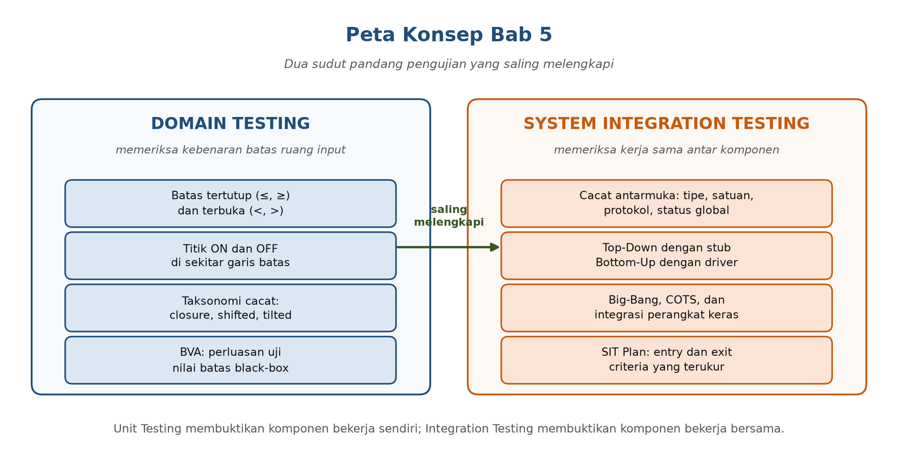
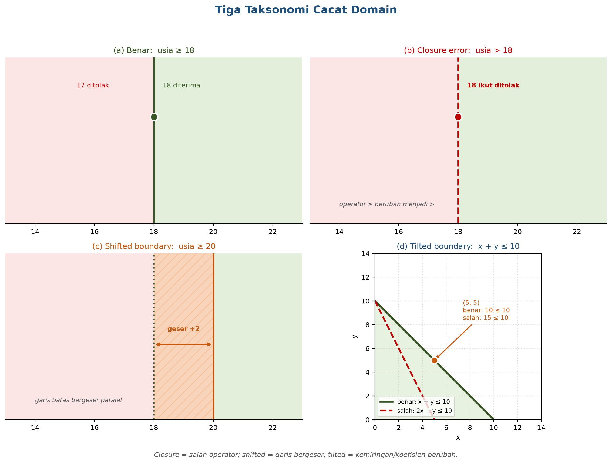
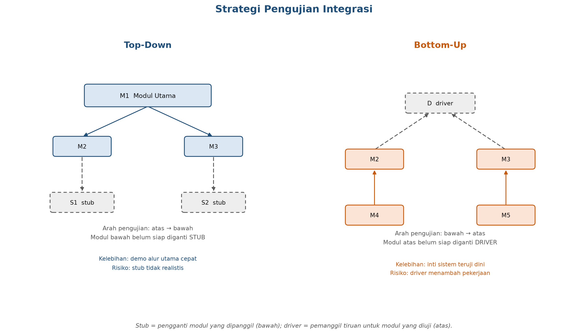

# A. Pendahuluan dan Cara Kerja

## A.1 Tujuan dan ruang lingkup tugas

Tugas ini menjawab sepuluh soal esai Bab 5 mata kuliah Software Quality Assurance (SQA) tentang **Arsitektur Kualitas Perangkat Lunak**, dengan dua pokok bahasan yang saling melengkapi:

1. **Domain Testing** — pengujian yang memeriksa kebenaran pembagian ruang input, terutama di sekitar batas domain, melalui titik ON dan titik OFF.
2. **System Integration Testing** — pengujian yang memeriksa kerja sama antar komponen setelah setiap unit lulus Unit Testing, meliputi cacat antarmuka, strategi integrasi, komponen COTS, serta Entry/Exit Criteria pada SIT Plan.

Setiap jawaban tidak hanya berisi definisi, tetapi juga tabel pembanding, contoh kasus, kaitan dengan materi modul, dan — untuk soal tertentu — demonstrasi program C++ yang benar-benar dikompilasi dan dijalankan. Dengan cara ini, jawaban dapat ditelusuri kembali ke bukti eksekusi, bukan sekadar klaim teoretis.

## A.2 Ringkasan jawaban

| Soal | Pokok bahasan | Inti jawaban |
|---|---|---|
| 1 | CFT vs Domain Testing | CFT memeriksa alur kendali; Domain Testing memeriksa kebenaran batas ruang input |
| 2 | Computation bug vs domain bug | Computation bug salah menghitung di dalam domain; domain bug salah menentukan batas |
| 3 | Batas usia ≥ 18 | Batas tertutup; ON = 18 (sah), OFF = 17 (tidak sah) |
| 4 | Taksonomi cacat domain | Closure (operator), shifted (posisi), tilted (kemiringan/koefisien) |
| 5 | Pentingnya integration testing | Unit lulus sendiri-sendiri, tetapi antarmuka dan asumsi antarunit belum teruji |
| 6 | Top-Down vs Bottom-Up | Top-Down memakai stub; Bottom-Up memakai driver |
| 7 | Komponen COTS | Komponen pihak ketiga siap pakai; tantangan utama ada pada kontrak, versi, dan ketergantungan vendor |
| 8 | Entry & Exit Criteria | Gerbang kesiapan sebelum uji dan syarat objektif untuk mengakhiri uji |
| 9 | Big-Bang | Menggabungkan semua modul sekaligus; sulit melacak sumber kegagalan |
| 10 | Domain Testing vs BVA | BVA adalah bentuk sederhana Domain Testing untuk satu variabel; Domain Testing memperluasnya ke banyak variabel dan batas miring |

## A.3 Peta konsep

Peta konsep berikut menunjukkan kedudukan kedua pokok bahasan. Domain Testing berfokus pada **kebenaran batas ruang input**, sedangkan System Integration Testing berfokus pada **kerja sama antar komponen**. Keduanya berada pada level pengujian yang berbeda, tetapi sama-sama bertujuan menemukan cacat yang tidak terlihat bila komponen hanya diuji secara terpisah.



## A.4 Perangkat dan struktur berkas

| Komponen | Keterangan |
|---|---|
| Kompiler | g++ 16.2.0 (MinGW-w64), mode `-std=c++17 -Wall -Wextra` |
| Bahasa demo | C++17, dua program: `domain_demo.cpp` dan `integrasi_demo.cpp` |
| Alat verifikasi | Python 3.15: `alat/verifikasi_tugas.py` memeriksa batas, harga, dan konversi satuan dengan `assert` |
| Dokumen | `isi_tugas.md` (sumber tunggal) → `Tugas_Bab5_Arsitektur_Kualitas.docx` dan `.pdf` |
| Bukti eksekusi | Folder `kode/hasil/` berisi keluaran program dan `laporan_eksekusi.txt` |

Struktur folder:

```text
Tugas-Bab5-Arsitektur-Kualitas/
├── dokumen/
│   ├── isi_tugas.md                    sumber isi dokumen
│   ├── mdparse.py                      parser markdown
│   ├── md2docx.py                      pembangkit Word
│   ├── md2pdf.py                       pembangkit PDF
│   ├── buat_gambar.py                  pembangkit gambar
│   ├── gambar/                         4 gambar PNG (200 dpi)
│   ├── Tugas_Bab5_Arsitektur_Kualitas.docx
│   └── Tugas_Bab5_Arsitektur_Kualitas.pdf
├── kode/
│   ├── domain_demo.cpp                 demo batas domain dan cacat domain
│   ├── integrasi_demo.cpp              demo unit vs integration testing
│   ├── jalankan_semua.ps1              kompilasi + eksekusi + verifikasi
│   ├── alat/verifikasi_tugas.py        pemeriksaan otomatis angka
│   ├── build/                          berkas executable
│   └── hasil/                          keluaran program + laporan
└── README.md
```

> Seluruh angka pada dokumen ini diperiksa ulang oleh `kode/alat/verifikasi_tugas.py`. Skrip tersebut berhenti dengan galat apabila ada satu saja nilai yang tidak konsisten, sehingga dokumen dan kode tidak dapat “berbeda cerita”.

# B. Jawaban Sepuluh Soal

## Soal 1 — Perbedaan Control Flow Testing dan Domain Testing

**Pertanyaan.** Jelaskan perbedaan utama antara fokus pengujian pada Control Flow Testing dan Domain Testing!

**Jawaban.**

**Control Flow Testing (CFT)** adalah pendekatan pengujian white-box yang memandang program sebagai **graf aliran kendali**. Program dipecah menjadi simpul (blok pernyataan) dan sisi (perpindahan kendali), lalu penguji memilih jalur, cabang, atau perulangan yang harus dieksekusi. Pertanyaan utamanya adalah: *“Bagian struktur kendali mana yang sudah dijalankan oleh kasus uji, dan bagian mana yang belum?”* Cacat yang diburu biasanya berupa cabang yang tidak pernah dieksekusi, perulangan yang salah, kondisi majemuk yang tidak lengkap diuji, atau jalur yang secara struktural ada tetapi tidak layak (infeasible).

**Domain Testing** memandang program dari sisi **ruang input**. Setiap variabel masukan memiliki domain nilai yang sah dan tidak sah, dan program pada dasarnya melakukan klasifikasi: menerima atau menolak suatu nilai berdasarkan batas-batas tertentu. Penguji memusatkan perhatian pada **batas domain** — garis, bidang, atau permukaan tempat keputusan berubah — dan memilih titik-titik di sekitarnya, terutama titik ON dan titik OFF. Pertanyaan utamanya adalah: *“Apakah program mengklasifikasikan nilai input dengan benar tepat di sekitar batas?”*

| Aspek | Control Flow Testing | Domain Testing |
|---|---|---|
| Sumber informasi utama | Kode sumber dan struktur kendali | Spesifikasi input, batas domain, kadang kode |
| Objek yang dipetakan | Simpul, sisi, cabang, jalur, perulangan | Variabel input, relasi, garis/bidang batas |
| Pertanyaan kunci | Jalur mana yang sudah dieksekusi? | Nilai mana yang salah diterima atau ditolak? |
| Cacat yang diburu | Cabang tak teruji, jalur infeasible, kesalahan loop | Closure, shifted boundary, tilted boundary |
| Kriteria khas | Statement, branch, path, condition coverage | Titik ON/OFF, uji batas satu dan multidimensi |
| Contoh sederhana | `if (usia >= 18)` memiliki dua cabang | Apakah 17, 18, dan 19 diklasifikasikan benar? |

Perbedaan ini penting karena **cakupan kendali yang tinggi tidak menjamin batas yang benar**. Perhatikan potongan kode berikut:

```cpp
if (usia >= 18) {
    cout << "Boleh mendaftar";
} else {
    cout << "Belum boleh mendaftar";
}
```

CFT dapat mencapai 100% branch coverage hanya dengan dua kasus: satu nilai yang membuat kondisi benar (misalnya 25) dan satu nilai yang membuat kondisi salah (misalnya 10). Kedua cabang sudah dieksekusi, tetapi **tidak ada satu pun kasus yang menguji nilai 18** sebagai titik batas. Jika programmer keliru menulis `>` alih-alih `>=`, kedua kasus tadi tetap memberi hasil yang sama; cacat baru terlihat ketika nilai 18 diuji. Di sinilah Domain Testing masuk: ia menempatkan kasus tepat di garis batas dan tepat di luar garis batas.

Dengan demikian, CFT dan Domain Testing tidak saling menggantikan. CFT menjawab pertanyaan **“apakah semua jalur sudah dijalankan?”**, sedangkan Domain Testing menjawab **“apakah semua nilai di sekitar batas sudah diklasifikasikan dengan benar?”** Pengujian yang baik biasanya memakai keduanya: CFT untuk memastikan tidak ada blok atau cabang yang terlewat, lalu Domain Testing untuk mempertajam kasus-kasus di sekitar keputusan.

## Soal 2 — Cacat Komputasi dan Cacat Domain

**Pertanyaan.** Apa bedanya antara Cacat Komputasi (Computation Bug) dan Cacat Domain (Domain Bug)? Berikan contoh kasus singkat!

**Jawaban.**

**Cacat komputasi (computation bug)** terjadi ketika program **salah menghitung** nilai di dalam domain yang sebenarnya sudah benar. Batas penerimaan input tidak bermasalah, tetapi rumus, operator aritmetika, pembulatan, atau logika perhitungan di dalamnya salah. Akibatnya, input yang seharusnya diproses dengan benar menghasilkan keluaran yang salah.

**Cacat domain (domain bug)** terjadi ketika program **salah menentukan batas atau kondisi** yang memisahkan input sah dan tidak sah. Bisa jadi operatornya salah (`>` seharusnya `>=`), angkanya bergeser (18 menjadi 20), atau relasi antar-variabelnya salah. Akibatnya, program menerima input yang seharusnya ditolak, atau menolak input yang seharusnya diterima, walaupun perhitungan di dalam masing-masing wilayah mungkin benar.

| Aspek | Cacat komputasi | Cacat domain |
|---|---|---|
| Letak kesalahan | Rumus atau proses di dalam domain | Batas, operator, atau relasi domain |
| Gejala | Keluaran salah untuk input yang sah | Input salah diklasifikasikan (diterima/ditolak) |
| Contoh kode | `harga * 0.8` seharusnya `harga * 0.5` | `usia <= 12` seharusnya `usia < 12` |
| Titik deteksi | Nilai nominal di dalam domain | Titik ON/OFF di sekitar batas |
| Strategi uji | Uji nilai representatif dan oracle perhitungan | Uji batas dan analisis domain |

**Contoh kasus: tiket bioskop.** Aturan yang berlaku: pengunjung berusia **kurang dari 12 tahun** mendapat harga anak **Rp25.000**, sedangkan usia 12 tahun ke atas membayar **Rp50.000**.

- **Cacat domain:** programmer menulis `usia <= 12` alih-alih `usia < 12`. Anak berusia tepat 12 tahun kemudian mendapat harga Rp25.000, padahal seharusnya Rp50.000. Perhitungan diskonnya sendiri benar; yang salah adalah batas penerimaannya.
- **Cacat komputasi:** programmer menulis batas dengan benar (`usia < 12`), tetapi rumus harga anaknya salah, misalnya `0.8 * 50000 = 40000` alih-alih `25000`. Anak berusia 10 tahun tetap dianggap anak, tetapi membayar Rp40.000, bukan Rp25.000.

| Usia | Harga benar | Dengan cacat domain (`<= 12`) | Dengan cacat komputasi (`0.8`) |
|---|---|---|---|
| 10 | 25.000 | 25.000 | 40.000 (salah) |
| 11 | 25.000 | 25.000 | 40.000 (salah) |
| 12 | 50.000 | 25.000 (salah) | 50.000 |
| 13 | 50.000 | 50.000 | 50.000 |
| 20 | 50.000 | 50.000 | 50.000 |

Tabel ini memperlihatkan pola yang khas. Cacat domain hanya muncul **tepat di batas** (usia 12), sedangkan cacat komputasi muncul **di dalam domain** (usia 10 dan 11). Karena itu, rangkaian uji yang hanya memakai nilai jauh dari batas — misalnya 5 dan 30 — akan melewatkan kedua cacat tersebut. Sebaliknya, rangkaian uji yang hanya memakai titik batas juga akan melewatkan cacat komputasi yang terjadi pada nilai nominal. Pengujian yang baik memerlukan **keduanya**: titik ON/OFF untuk cacat domain, dan nilai representatif di dalam domain dengan oracle yang benar untuk cacat komputasi.

Contoh lain yang sering terjadi adalah perhitungan pajak. Batas penghasilan tidak kena pajak mungkin sudah benar, tetapi tarif yang dipakai salah (5% ditulis 10%). Ini cacat komputasi. Sebaliknya, jika batas penghasilan salah (Rp50 juta ditulis Rp60 juta) tetapi tarifnya benar, itu cacat domain. Dalam praktik, keduanya bisa muncul bersamaan, sehingga penguji perlu memisahkan penyebab kegagalan: apakah salah **memilih wilayah**, atau salah **menghitung di dalam wilayah**.

## Soal 3 — Batas Usia ≥ 18, Titik ON dan OFF

**Pertanyaan.** Jika sebuah aturan sistem menyatakan: “Pengguna dapat mendaftar jika usia minimal 18 tahun” (Usia ≥ 18), tentukan jenis batasnya (terbuka/tertutup), serta tentukan nilai Titik ON dan Titik OFF untuk pengujian domain tersebut!

**Jawaban.**

Aturan “usia minimal 18 tahun” ditulis sebagai **Usia ≥ 18**. Tanda **≥** berarti nilai 18 **termasuk** ke dalam domain yang sah. Dengan demikian batasnya adalah **batas tertutup (closed boundary)**.

Untuk usia yang dinyatakan dalam bilangan bulat, domainnya adalah:

- **Domain sah:** 18, 19, 20, 21, … (dari 18 sampai tak hingga)
- **Domain tidak sah:** 17, 16, 15, … (dari 17 ke bawah)

**Titik ON** adalah titik yang berada tepat di garis batas dan, pada batas tertutup, berada **di dalam** domain sah. Jadi **ON = 18**. **Titik OFF** adalah tetangga terdekat dari titik ON yang berada **di luar** domain sah. Untuk bilangan bulat, tetangga terdekat di bawah 18 adalah **17**, sehingga **OFF = 17**.

| Titik | Nilai | Wilayah | Hasil yang diharapkan | Alasan |
|---|---|---|---|---|
| OFF | 17 | Di luar domain | Ditolak | Satu tahun di bawah batas |
| ON | 18 | Tepat di batas, di dalam domain | Diterima | Batas tertutup, 18 termasuk |
| ON + 1 | 19 | Di dalam domain | Diterima | Menguji sisi dalam yang berdekatan |
| Nominal | 25 | Di dalam domain | Diterima | Memastikan alur normal tetap bekerja |

Perlu dicatat bahwa pemilihan OFF = 17 bergantung pada **domain bilangan bulat**. Jika sistem menerima usia sebagai bilangan real (misalnya 17,5 tahun), maka tidak ada nilai real terbesar yang kurang dari 18. Dalam kasus itu, titik OFF dinyatakan sebagai **18 − ε**, misalnya 17,999 atau 17,99 sesuai presisi yang disepakati. Yang penting bukan angka desimalnya, melainkan posisinya: **tepat di luar batas**, bukan jauh dari batas.

Sebagai pembanding, jika aturannya berbunyi **Usia > 18** (tanpa tanda sama dengan), batasnya menjadi **terbuka**. Pada konvensi modul, titik ON tetap berada di garis batas, tetapi kini berada **di luar** domain sah, sehingga ON = 18 dan OFF = 19 (tetangga terdekat di dalam domain). Perbedaan satu karakter ini — `≥` versus `>` — adalah salah satu cacat domain yang paling sering terjadi dan justru paling sulit terdeteksi bila pengujian tidak menempatkan kasus tepat di angka 18.

Rangkaian uji minimal untuk aturan Usia ≥ 18 adalah:

1. **17** → harus ditolak (OFF, mendeteksi batas yang bergeser ke kiri).
2. **18** → harus diterima (ON, mendeteksi closure error `>` dan pergeseran ke kanan).
3. **19** → harus diterima (ON+1, memastikan sisi dalam tetap bekerja).
4. **25** → harus diterima (nilai nominal, memastikan alur normal tidak rusak).

Jika sistem memiliki batas atas tambahan — misalnya usia maksimal 100 tahun — maka batas atas itu diperlakukan dengan cara yang sama: tentukan terbuka/tertutup, lalu ambil ON dan OFF di sekitarnya. Inilah yang disebut pengujian **titik ekstrim** pada domain multidimensi: setiap sudut atau ujung domain perlu diuji, bukan hanya satu batas.

## Soal 4 — Tiga Taksonomi Cacat Domain

**Pertanyaan.** Sebutkan dan jelaskan tiga jenis taksonomi cacat domain (Closure Error, Shifted-Boundary Error, Tilted-Boundary Error)!

**Jawaban.**

Ketika programmer salah menulis batas domain, kesalahannya biasanya dapat dikelompokkan menjadi tiga pola. Pengelompokan ini penting karena setiap pola membutuhkan titik uji yang berbeda.

| Taksonomi | Inti kesalahan | Contoh benar → salah | Cara mendeteksi |
|---|---|---|---|
| **Closure Error** | Salah memilih operator batas (tertutup vs terbuka) | `usia >= 18` → `usia > 18` | Titik ON tepat di batas (18) |
| **Shifted-Boundary Error** | Garis batas bergeser paralel, angkanya salah | `total >= 100000` → `total >= 99999` | Titik ON dan OFF di kedua sisi batas |
| **Tilted-Boundary Error** | Kemiringan atau koefisien relasi antar-variabel salah | `x + y <= 10` → `2x + y <= 10` | Beberapa titik pada garis, terutama titik ekstrim |

**1. Closure Error.** Cacat ini terjadi ketika **jenis batas** salah, bukan posisinya. Garis batasnya tetap di angka yang benar, tetapi nilai tepat di garis diperlakukan berbeda. Contoh: aturan sebenarnya `usia >= 18`, ditulis `usia > 18`. Garisnya tetap di 18, tetapi 18 sekarang ditolak. Cacat ini paling efektif dideteksi oleh **titik ON**: satu-satunya nilai yang membedakan `>= 18` dan `> 18` adalah 18 itu sendiri.

**2. Shifted-Boundary Error.** Cacat ini terjadi ketika garis batas **bergeser sejajar** ke kiri atau ke kanan. Contoh: aturan sebenarnya `total >= 100000`, ditulis `total >= 99999` (bergeser Rp1 ke kiri) atau `total >= 100001` (bergeser Rp1 ke kanan). Di sini operatornya sudah benar dan bentuk garisnya benar; yang salah adalah posisinya. Untuk mendeteksinya, penguji harus memeriksa nilai **tepat di batas yang seharusnya** dan **tepat di luar batas yang seharusnya**. Jika hanya diuji nilai 50.000 dan 150.000, pergeseran Rp1 tidak akan terlihat.

**3. Tilted-Boundary Error.** Cacat ini hanya muncul pada domain **multidimensi**, ketika batas berupa garis atau bidang yang melibatkan dua variabel atau lebih. Kesalahannya bukan pada posisi garis secara keseluruhan, melainkan pada **kemiringan** garis akibat koefisien atau relasi yang salah. Contoh: aturan sebenarnya `x + y <= 10`, ditulis `2x + y <= 10`. Pada titik (0,10) dan (10,0) kedua garis masih bertemu, tetapi di tengah — misalnya (5,5) — nilai `x + y = 10` masih sah sedangkan `2x + y = 15` sudah melanggar. Satu titik uji di dekat ujung garis belum tentu cukup; penguji perlu beberapa titik di sepanjang garis, terutama di sekitar titik ekstrim, untuk melihat perubahan kemiringan.



Catatan penting: modul kadang memberi contoh tilted sebagai `x + y <= 10` yang ditulis `x + y <= 12`. Secara geometris, mengubah angka 10 menjadi 12 **menggeser** garis sejajar, sehingga lebih tepat digolongkan sebagai shifted. Kemiringan sejati berubah ketika **koefisien** salah, misalnya `2x + y <= 10` atau `x + 0,5y <= 10`. Memahami perbedaan ini penting agar penguji memilih titik uji yang benar: shifted cukup dideteksi dengan titik di sekitar satu batas, sedangkan tilted memerlukan beberapa titik di sepanjang garis.

Ketiga cacat ini juga menjelaskan mengapa pengujian domain tidak cukup hanya dengan satu nilai “di dalam” dan satu nilai “di luar”. Diperlukan **pasangan titik ON/OFF** untuk closure dan shifted, serta **beberapa titik pada garis** untuk tilted. Inilah inti dari kriteria seleksi White & Cohen: pilih titik-titik di sekitar batas linier sedemikian rupa sehingga pergeseran dan perubahan tipe batas dapat terdeteksi.

## Soal 5 — Pentingnya Pengujian Integrasi Sistem

**Pertanyaan.** Mengapa pengujian integrasi sistem sangat penting meskipun setiap unit kode di dalam sistem tersebut telah diuji dan dinyatakan 100% lulus pada tahap Unit Testing?

**Jawaban.**

Unit Testing menguji **satu unit dalam isolasi**. Unit bisa berupa fungsi, kelas, atau modul kecil. Pada tahap ini, penguji memakai stub atau driver untuk menggantikan komponen lain, lalu memeriksa apakah unit tersebut memenuhi spesifikasinya sendiri. Hasil “100% lulus” berarti setiap unit bekerja benar **dengan asumsi yang diberikan oleh pengujinya**, bukan berarti unit-unit itu bekerja benar ketika disatukan.

Pengujian integrasi sistem menjadi penting karena cacat yang paling sering muncul justru berada di **titik temu** antarunit, bukan di dalam unit. Beberapa jenis cacat tersebut adalah:

1. **Ketidakcocokan antarmuka.** Fungsi dipanggil dengan jumlah parameter, urutan, atau tipe data yang salah. Unit pemanggil dan unit yang dipanggil sama-sama lulus uji sendiri-sendiri, tetapi gagal saat dihubungkan.
2. **Ketidakcocokan satuan atau format data.** Modul A mengirim jarak dalam meter, modul B membacanya sebagai sentimeter. Modul A mengirim tanggal `YYYY-MM-DD`, modul B mengharapkan `DD/MM/YYYY`.
3. **Ketidakcocokan protokol atau kontrak.** Satu komponen mengharapkan pesan JSON, komponen lain mengirim XML; satu pihak memakai versi API lama, pihak lain memakai versi baru.
4. **Status global dan sumber daya bersama.** Dua modul mengubah variabel global, berkas, atau koneksi basis data yang sama tanpa kesepakatan urutan akses.
5. **Urutan, waktu, dan propagasi kesalahan.** Integrasi memperlihatkan apakah kesalahan dari satu modul ditangani dengan benar oleh modul lain, apakah ada race condition, atau apakah timeout terjadi.
6. **Asumsi yang tidak realistis pada stub.** Stub sering dibuat “baik” dan selalu mengembalikan nilai yang diharapkan. Ketika komponen nyata dipasang, perilakunya berbeda: lambat, gagal, atau mengembalikan format lain.
7. **Perilaku yang muncul saat komponen digabung (emergent behavior).** Interaksi antarunit dapat menghasilkan kondisi yang tidak pernah muncul pada pengujian unit, misalnya beban tinggi, kebuntuan (deadlock), atau konfigurasi yang saling bertentangan.
8. **Komponen pihak ketiga dan perangkat keras.** COTS, basis data, payment gateway, printer, atau sensor nyata memiliki perilaku yang tidak dapat direplikasi sempurna oleh mock.

Contoh nyata dapat dilihat pada program `integrasi_demo.cpp` yang disertakan. Modul `SensorJarak` mengembalikan **1,25 meter** dan lulus unit test karena nilainya sesuai spesifikasi sensor. Modul `Layar` menerima nilai dalam **sentimeter** dan juga lulus unit test ketika diberi 125,0 cm. Namun, ketika keduanya diintegrasikan tanpa adapter, layar menerima angka 1,25 dan menampilkan **“1.25 cm”**, bukan **“125.00 cm”**. Kedua unit lulus, tetapi integrasinya gagal. Cacat seperti ini tidak mungkin ditemukan oleh Unit Testing karena baru muncul pada **kontrak antarmuka**.

| Aspek | Unit Testing | Integration Testing |
|---|---|---|
| Cakupan | Satu fungsi/kelas/modul | Gabungan modul dan antarmukanya |
| Lingkungan | Terisolasi, memakai stub/driver | Komponen nyata atau mendekati nyata |
| Cacat khas | Logika internal unit | Tipe data, satuan, protokol, status, urutan |
| Pertanyaan kunci | Apakah unit sesuai spesifikasinya? | Apakah unit-unit bekerja sama? |
| Risiko bila dilewati | Cacat antarmuka baru ditemukan di produksi | Biaya perbaikan jauh lebih mahal |

Selain itu, semakin lama cacat integrasi ditemukan, semakin mahal biaya perbaikannya. Cacat antarmuka yang ditemukan saat integrasi masih relatif murah karena arsitektur dan kontrak masih dapat diubah. Cacat yang sama, jika baru ditemukan setelah sistem dirilis, dapat memaksa perubahan desain, migrasi data, atau penarikan versi. Pengujian integrasi juga menjadi sarana **verifikasi arsitektur**: apakah pembagian modul, arah ketergantungan, dan kontrak antarmuka benar-benar berjalan seperti yang dirancang.

Kesimpulannya, 100% Unit Testing adalah syarat perlu, tetapi bukan syarat cukup. Unit Testing membuktikan bahwa **komponen bekerja sendiri**; Integration Testing membuktikan bahwa **komponen bekerja bersama**. Keduanya menguji jenis risiko yang berbeda dan tidak dapat saling menggantikan.

## Soal 6 — Top-Down dan Bottom-Up

**Pertanyaan.** Jelaskan perbedaan karakteristik antara strategi pengujian integrasi Top-Down dan Bottom-Up, serta sebutkan komponen bantuan apa yang digunakan pada masing-masing strategi!

**Jawaban.**

Strategi integrasi menentukan **urutan** modul yang digabungkan dan **komponen bantuan** yang dipakai untuk menggantikan modul yang belum siap.

**Top-Down Integration** dimulai dari **modul paling atas** (modul utama atau kendali), lalu turun ke modul-modul yang dipanggilnya. Modul bawah yang belum selesai digantikan oleh **stub**, yaitu program tiruan yang meniru antarmuka modul bawah dan mengembalikan nilai yang sudah ditentukan. Dengan cara ini, alur kendali utama dan antarmuka tingkat atas dapat diuji lebih awal.

**Bottom-Up Integration** bergerak sebaliknya: dimulai dari **modul paling bawah** (modul dasar yang tidak memanggil modul lain), lalu naik ke modul yang memanggilnya. Modul atas yang belum selesai digantikan oleh **driver**, yaitu program tiruan yang memanggil modul yang sedang diuji, memberikan input, dan memeriksa keluarannya. Strategi ini memungkinkan modul dasar diuji secara nyata lebih awal, tanpa menunggu modul atas selesai.

| Aspek | Top-Down | Bottom-Up |
|---|---|---|
| Arah integrasi | Atas → bawah | Bawah → atas |
| Komponen bantuan | **Stub** (pengganti modul bawah) | **Driver** (pemanggil modul atas) |
| Yang diuji lebih awal | Alur kendali utama, antarmuka tingkat atas | Modul dasar, logika inti, utilitas |
| Kelebihan | Demo alur utama cepat; keputusan arsitektur teruji dini | Modul inti teruji nyata; driver relatif sederhana |
| Kekurangan | Stub banyak dan bisa tidak realistis; cacat modul bawah ditemukan terlambat | Perilaku tingkat atas baru terlihat belakangan; driver menambah pekerjaan |
| Cocok untuk | Sistem dengan kendali atas yang stabil dan kritis | Sistem dengan modul dasar yang kompleks atau dipakai ulang |

Perbedaan **stub** dan **driver** sering tertukar. Cara mudah mengingatnya: **stub** adalah “kaki palsu” di bawah — ia menggantikan modul yang **dipanggil** oleh modul yang sedang diuji. **Driver** adalah “kepala palsu” di atas — ia menggantikan modul yang **memanggil** modul yang sedang diuji. Pada Top-Down, modul atas sudah nyata dan modul bawah masih palsu, sehingga yang dipakai adalah stub. Pada Bottom-Up, modul bawah sudah nyata dan modul atas masih palsu, sehingga yang dipakai adalah driver.



**Contoh sistem e-commerce.** Misalkan modul utamanya adalah **Checkout** dan modul bawahnya adalah **Gateway Pembayaran**.

- Pada **Top-Down**, tim menguji alur Checkout terlebih dahulu — memilih barang, menghitung total, menampilkan ringkasan — sementara Gateway Pembayaran diganti stub yang selalu mengembalikan “pembayaran berhasil”. Alur utama cepat terlihat, tetapi cacat pada gateway nyata (misalnya waktu respons lambat atau format respons berbeda) belum terdeteksi.
- Pada **Bottom-Up**, tim menguji koneksi ke Gateway Pembayaran terlebih dahulu dengan driver yang memberikan berbagai nominal dan memeriksa respons. Setelah gateway stabil, barulah modul Checkout disambungkan. Modul pembayaran yang paling berisiko teruji lebih awal, tetapi perilaku checkout secara keseluruhan baru terlihat belakangan.

Dalam praktik, banyak proyek memakai **strategi hibrida (sandwich)**: top-down untuk alur kendali utama, bottom-up untuk modul dasar yang berisiko tinggi, lalu integrasi penuh di tengah. Pemilihan strategi sebaiknya didasarkan pada **risiko**: modul mana yang paling mungkin gagal, modul mana yang paling mahal jika cacatnya terlambat ditemukan, dan komponen bantuan mana yang paling realistis dibuat.

## Soal 7 — Komponen COTS dan Tantangan Integrasinya

**Pertanyaan.** Apa yang dimaksud dengan komponen COTS (Commercial Off-The-Shelf), dan apa tantangan utama dalam mengintegrasikannya ke dalam sistem perangkat lunak buatan sendiri?

**Jawaban.**

**COTS (Commercial Off-The-Shelf)** adalah komponen perangkat lunak **siap pakai** yang dikembangkan dan dijual oleh pihak ketiga, lalu dibeli atau dilisensikan untuk digunakan dalam sistem lain. Pengguna tidak memiliki kode sumbernya secara penuh dan biasanya tidak bebas mengubah perilakunya. Contoh yang umum adalah payment gateway (misalnya Midtrans atau Stripe), peta digital (Google Maps), basis data komersial, layanan autentikasi, CRM, atau pustaka komersial untuk laporan dan analitik.

COTS dipakai karena menghemat waktu dan biaya: organisasi tidak perlu membangun sendiri fungsi yang sudah matang, teruji, dan dipelihara vendor. Namun, penggunaan COTS **memindahkan risiko**, bukan menghilangkan risiko. Tantangan utamanya justru muncul di **batas integrasi** antara komponen COTS dan kode buatan sendiri.

| Tantangan | Penjelasan | Dampak bila tidak dikelola |
|---|---|---|
| Ketidakcocokan API/kontrak | Nama fungsi, tipe data, format pesan, atau versi API berbeda | Integrasi gagal atau data salah terbaca |
| Format dan satuan data | COTS memakai format tanggal, mata uang, atau satuan yang berbeda | Nilai salah, konversi hilang, pembulatan keliru |
| Versi dan pembaruan | Vendor merilis versi baru yang mengubah perilaku atau menghapus API lama | Sistem tiba-tiba rusak saat upgrade |
| Keterbatasan akses kode | Kode sumber tidak tersedia, sehingga akar masalah sulit dianalisis | Perbaikan bergantung pada vendor |
| Ketergantungan vendor (lock-in) | Sulit pindah vendor karena data, kontrak, atau integrasi sudah melekat | Biaya dan risiko jangka panjang meningkat |
| Lisensi dan biaya | Model lisensi per pengguna, per transaksi, atau per server | Biaya membengkak saat skala naik |
| Keamanan dan kepatuhan | Data pelanggan melewati pihak ketiga | Risiko privasi, regulasi, dan kebocoran data |
| SLA dan dukungan | Jaminan layanan, waktu respons, dan eskalasi terbatas | Insiden produksi tertunda penyelesaiannya |
| Lingkungan uji | Sandbox vendor mungkin tidak identik dengan produksi | Uji lulus di sandbox, gagal di produksi |
| Kustomisasi terbatas | Perilaku tidak dapat diubah sesuai kebutuhan khusus | Terpaksa menambah lapisan adapter atau workaround |
| Kinerja dan kuota | Batas panggilan API, latensi jaringan, kuota transaksi | Sistem melambat atau transaksi ditolak |
| End-of-life | Vendor menghentikan produk | Perlu migrasi mendadak |

**Contoh: integrasi payment gateway.** Kode internal mengirim nominal dalam rupiah, tetapi API gateway meminta nominal dalam satuan terkecil (misalnya sen) atau memakai format desimal tertentu. Kode internal memakai waktu lokal, sedangkan gateway memakai UTC. Di lingkungan sandbox, transaksi selalu berhasil; di produksi, transaksi gagal karena kunci API, IP whitelist, atau aturan 3-D Secure berbeda. Semua masalah ini bukan cacat di dalam kode internal dan bukan cacat di dalam gateway, melainkan cacat **integrasi**.

**Cara mengelola tantangan COTS.**

1. **Contract testing**: uji kontrak API secara eksplisit — tipe data, format, kode kesalahan, dan batas nilai.
2. **Adapter atau facade**: bungkus COTS dengan lapisan tipis agar perubahan API vendor tidak merambat ke seluruh sistem.
3. **Sandbox yang representatif**: uji di lingkungan yang sedekat mungkin dengan produksi, termasuk kuota dan konfigurasi.
4. **Version pinning dan rencana upgrade**: kunci versi yang dipakai, pantau pengumuman vendor, dan siapkan uji regresi sebelum naik versi.
5. **Uji penerimaan COTS**: verifikasi perilaku komponen terhadap kebutuhan bisnis, bukan hanya terhadap dokumentasinya.
6. **Manajemen risiko vendor**: catat ketergantungan, SLA, biaya, dan rencana keluar (exit strategy).
7. **Pemantauan produksi**: pantau latensi, tingkat kegagalan, dan perubahan perilaku setelah pembaruan vendor.

Kesimpulannya, COTS dapat mempercepat pengembangan, tetapi kualitas akhir sistem tetap menjadi tanggung jawab tim pengembang. Pengujian integrasi harus memverifikasi bahwa komponen komersial itu **benar-benar klop** dengan kode internal, data, keamanan, dan lingkungan operasional.

## Soal 8 — Entry Criteria dan Exit Criteria pada SIT Plan

**Pertanyaan.** Apa fungsi dari Entry Criteria dan Exit Criteria di dalam dokumen Rencana Pengujian Integrasi (SIT Plan)?

**Jawaban.**

**SIT Plan (System Integration Test Plan)** adalah dokumen cetak biru yang mendefinisikan ruang lingkup, jadwal, lingkungan, sumber daya, risiko, dan kriteria keberhasilan pengujian integrasi. Di dalamnya, **Entry Criteria** dan **Exit Criteria** berfungsi sebagai **gerbang objektif** yang mencegah pengujian dimulai terlalu dini atau berakhir terlalu cepat.

**Entry Criteria (syarat mulai)** adalah kondisi yang harus terpenuhi **sebelum** pengujian integrasi dimulai. Tujuannya memastikan bahwa bahan yang akan diuji sudah siap, sehingga waktu pengujian tidak habis untuk memperbaiki hal-hal mendasar. Contohnya:

- seluruh unit telah lulus Unit Testing sesuai target, misalnya 100% untuk unit kritis;
- kode telah melalui code review dan tidak ada perubahan besar yang belum stabil;
- antarmuka dan kontrak data antarunit sudah dibekukan (interface freeze);
- lingkungan uji, basis data, dan data uji sudah tersedia;
- komponen COTS, sertifikat, kunci API, dan akses jaringan sudah dikonfigurasi;
- tim penguji, jadwal, dan alat pelaporan sudah siap.

**Exit Criteria (syarat selesai)** adalah kondisi yang harus terpenuhi **untuk mengakhiri** pengujian integrasi. Tujuannya mencegah pengujian berlangsung tanpa batas, sekaligus memastikan hasilnya cukup untuk mengambil keputusan rilis. Contohnya:

- persentase kasus uji lulus mencapai target, misalnya ≥ 95%;
- seluruh jalur integrasi kritis sudah dijalankan dan lulus;
- tidak ada cacat terbuka berkategori **Critical** atau **Blocker**;
- cacat berkategori **Major** sudah ditutup atau disetujui untuk ditunda dengan risiko yang tercatat;
- kinerja antarmuka memenuhi ambang batas, misalnya waktu respons < 2 detik;
- laporan hasil, matriks keterlacakan, dan berita acara sign-off sudah lengkap.

| Aspek | Entry Criteria | Exit Criteria |
|---|---|---|
| Waktu | Sebelum pengujian dimulai | Sebelum pengujian dinyatakan selesai |
| Pertanyaan | “Apakah kita sudah siap menguji?” | “Apakah kita sudah cukup yakin untuk berhenti?” |
| Contoh | Unit lulus, antarmuka beku, lingkungan siap | 95% lulus, tidak ada Critical, sign-off |
| Fungsi | Mencegah uji dimulai dengan bahan mentah | Mencegah uji berhenti tanpa dasar objektif |
| Risiko bila tidak ada | Waktu terbuang, hasil tidak valid | Pengujian tanpa akhir atau rilis prematur |

Fungsi keduanya dapat diringkas menjadi lima hal:

1. **Gerbang kualitas (quality gate).** Entry memastikan kesiapan; Exit memastikan kelayakan hasil.
2. **Dasar objektif untuk keputusan.** Bukan “rasanya sudah cukup”, tetapi angka dan daftar cacat yang disepakati.
3. **Pengendalian risiko.** Kriteria dapat disesuaikan dengan tingkat risiko sistem; sistem medis atau finansial memerlukan ambang yang lebih ketat.
4. **Alat komunikasi.** Semua pihak — pengembang, penguji, manajer, dan pemilik produk — memiliki pemahaman yang sama tentang kapan uji dimulai dan berakhir.
5. **Audit dan keterlacakan.** Dokumen SIT Plan menjadi bukti bahwa pengujian dilakukan secara terencana dan dapat dipertanggungjawabkan.

Agar berfungsi, kedua kriteria harus **terukur, disepakati sebelum pengujian, dan realistis**. Kriteria yang berbunyi “semua bug harus hilang” tidak realistis dan tidak terukur; kriteria yang berbunyi “tidak ada bug Critical, ≥ 95% kasus lulus, dan seluruh jalur pembayaran lulus” jauh lebih dapat dijalankan.

## Soal 9 — Metode Big-Bang dan Risikonya

**Pertanyaan.** Jelaskan apa yang dimaksud dengan metode integrasi Big-Bang, dan mengapa metode ini sangat tidak disarankan untuk proyek perangkat lunak skala besar yang kompleks!

**Jawaban.**

**Big-Bang Integration** adalah strategi di mana **semua modul digabungkan sekaligus** dalam satu waktu, lalu diuji sebagai satu sistem utuh. Tidak ada integrasi bertahap, tidak ada stub atau driver, dan tidak ada urutan prioritas modul. Begitu semua unit selesai, semuanya dipasang, dikonfigurasi, dan dijalankan bersama.

Metode ini terlihat sederhana dan cepat, tetapi justru menyimpan risiko besar, terutama untuk sistem yang kompleks:

1. **Sulit melacak sumber kegagalan.** Jika sistem gagal, penyebabnya bisa berada di puluhan antarmuka, konfigurasi, atau interaksi antar-modul. Tim harus menebak dan menelusuri satu per satu.
2. **Cacat saling menutupi.** Satu kesalahan dapat memicu kesalahan lain, sehingga gejala yang terlihat bukan penyebab sebenarnya. Debugging menjadi jauh lebih rumit.
3. **Tidak ada umpan balik dini.** Seluruh risiko integrasi baru diketahui di akhir proyek, ketika waktu dan anggaran hampir habis.
4. **Ledakan kombinasi antarmuka.** Dengan n modul, jumlah interaksi yang mungkin tumbuh jauh lebih cepat daripada jumlah modulnya. Menguji semuanya sekaligus membuat ruang pencarian penyebab menjadi sangat besar.
5. **Sulit mengisolasi lingkungan.** Konflik konfigurasi, basis data, port, sertifikat, dan versi pustaka bercampur dalam satu kegagalan.
6. **Biaya perbaikan tinggi.** Perbaikan di akhir siklus biasanya menuntut perubahan desain, pengujian ulang besar-besaran, dan penjadwalan ulang.
7. **Tidak cocok untuk tim paralel.** Banyak tim harus menunggu semua modul selesai sebelum dapat menguji, sehingga waktu tunggu dan risiko integrasi menumpuk.

Sebagai gambaran, bayangkan sistem dengan 20 modul. Jika pengujian Big-Bang menemukan satu kegagalan, ada banyak kemungkinan penyebab: 20 modul, puluhan antarmuka, konfigurasi, dan data. Dengan integrasi bertahap, penguji hanya menambahkan satu modul pada satu waktu; ketika kegagalan muncul, kandidat penyebabnya jauh lebih sempit — biasanya modul yang baru ditambahkan atau antarmukanya.

| Aspek | Big-Bang | Integrasi bertahap |
|---|---|---|
| Urutan | Semua sekaligus | Satu per satu atau kelompok kecil |
| Isolasi kegagalan | Sangat sulit | Relatif mudah |
| Umpan balik | Di akhir | Sejak tahap awal |
| Kebutuhan stub/driver | Tidak ada | Ada, sesuai strategi |
| Risiko proyek besar | Sangat tinggi | Dapat dikendalikan |
| Cocok untuk | Sistem kecil, prototipe, eksperimen | Sistem besar dan kompleks |

Big-Bang masih dapat diterima untuk sistem yang **sangat kecil**, jumlah modulnya sedikit, antarmukanya sederhana, atau untuk prototipe yang tidak akan dirilis. Namun, untuk sistem besar yang kompleks — apalagi yang memiliki banyak tim, komponen COTS, dan integrasi perangkat keras — metode ini sangat tidak disarankan. Pendekatan bertahap seperti Top-Down, Bottom-Up, atau hibrida memberikan **isolasi kegagalan**, **umpan balik dini**, dan **pengendalian risiko** yang jauh lebih baik.

## Soal 10 — Hubungan Domain Testing dan Black-Box BVA

**Pertanyaan.** Bagaimana hubungan antara konsep pengujian batas domain (Domain Testing) dengan metode pengujian fungsional Black-Box Testing (khususnya Boundary Value Analysis)?

**Jawaban.**

**Boundary Value Analysis (BVA)** adalah teknik Black-Box Testing yang berfokus pada nilai-nilai di sekitar batas suatu rentang input. BVA biasanya dimulai dari **partitioning** (membagi ruang input menjadi kelas ekuivalen yang sah dan tidak sah), lalu memilih nilai **minimum**, **minimum + 1**, **maksimum**, **maksimum − 1**, dan **nilai nominal** untuk setiap kelas. Karena berbasis spesifikasi, BVA tidak memerlukan akses ke kode sumber.

**Domain Testing** memiliki akar yang sama, tetapi lebih luas dan lebih geometris. Ia memandang ruang input sebagai **ruang berdimensi** yang dibatasi oleh garis, bidang, atau permukaan. Pengujian diarahkan pada **kebenaran batas** itu, dengan titik ON dan OFF, serta memperhitungkan jenis batas (tertutup/terbuka), posisi garis (shifted), dan kemiringan garis (tilted). Domain Testing dapat dilakukan hanya dengan spesifikasi, tetapi juga dapat memanfaatkan kode untuk memahami bagaimana batas diimplementasikan.

Hubungan keduanya dapat diringkas sebagai berikut:

| Aspek | Boundary Value Analysis (BVA) | Domain Testing |
|---|---|---|
| Sumber | Spesifikasi fungsional (black-box) | Spesifikasi dan/atau struktur domain |
| Dimensi | Umumnya satu variabel per analisis | Satu atau banyak variabel sekaligus |
| Titik uji | min, min+1, max, max−1, nominal | Titik ON/OFF dan beberapa titik pada garis |
| Fokus cacat | Nilai batas yang salah | Closure, shifted, tilted, dan kombinasi batas |
| Perluasan | 2-value dan 3-value BVA | Uji batas multidimensi dan titik ekstrim |
| Posisi | Teknik praktis yang umum | Kerangka konseptual yang lebih umum |

Dengan kata lain, **BVA adalah bentuk sederhana dari Domain Testing untuk satu dimensi**. Ketika aturan hanya melibatkan satu variabel — misalnya `usia >= 18` — BVA dan Domain Testing menghasilkan titik yang serupa: 17 (OFF), 18 (ON), dan 19 (nilai dalam). Domain Testing menambahkan analisis eksplisit tentang **jenis batas**: karena `>=` adalah batas tertutup, 18 harus diterima; jika kode menulis `>`, 18 akan ditolak dan itulah cacatnya.

Perbedaan menjadi lebih jelas pada domain **multidimensi**. Misalkan aturan `x + y <= 10`. BVA yang dilakukan per variabel mungkin menguji `x = 9, 10, 11` dan `y = 9, 10, 11`, tetapi kombinasi seperti `(5,5)` dan `(9,1)` belum tentu tercakup. Padahal, kombinasi itulah yang dapat mengungkap **tilted boundary** jika kode menulis `2x + y <= 10`. Domain Testing secara eksplisit memilih titik-titik pada garis batas dan titik ekstrim, sehingga perubahan kemiringan lebih mudah terdeteksi.

Selain itu, Domain Testing memperkenalkan **titik ON dan OFF** sebagai pasangan yang sistematis. BVA sering hanya menyebut “nilai batas” dan “nilai di luar batas”, sedangkan Domain Testing menegaskan posisi keduanya relatif terhadap domain sah: pada batas tertutup, ON di dalam dan OFF di luar; pada batas terbuka, ON di luar dan OFF di dalam. Konvensi ini mengurangi ambiguitas dan memastikan penguji benar-benar menguji kedua sisi batas.

Kesimpulannya, BVA adalah **pintu masuk praktis** ke Domain Testing. Keduanya bertujuan menemukan cacat batas, tetapi Domain Testing memberikan kerangka yang lebih lengkap: jenis batas, posisi garis, kemiringan, dan kombinasi variabel. Dalam praktik, tim yang memakai BVA sudah melakukan sebagian besar Domain Testing untuk kasus satu variabel; untuk sistem yang kompleks, BVA perlu diperluas dengan analisis domain multidimensi agar cacat seperti tilted boundary tidak lolos.

# C. Studi Kasus dan Hasil Eksekusi

## C.1 Demonstrasi cacat domain dan batas ON/OFF

Program `domain_demo.cpp` membandingkan empat implementasi aturan pendaftaran: implementasi benar (`>= 18`), closure error (`> 18`), shifted ke kanan (`>= 19`), dan shifted ke kiri (`>= 17`). Program juga membandingkan tiga implementasi harga tiket: benar, cacat domain (`<= 12`), dan cacat komputasi (`0.8`).

[[AMBIL:../kode/hasil/domain_demo.txt]]

Hasil ini memperlihatkan tiga hal penting. Pertama, **titik ON 18** mendeteksi closure error dan pergeseran ke kanan, karena hanya nilai 18 yang membedakan `>= 18`, `> 18`, dan `>= 19`. Kedua, **titik OFF 17** mendeteksi pergeseran ke kiri, karena hanya nilai 17 yang membedakan `>= 18` dan `>= 17`. Ketiga, nilai 19 dan 25 **tidak membedakan** keempat implementasi; jika penguji hanya memakai nilai-nilai itu, semua versi tampak benar. Inilah alasan mengapa pengujian batas harus menempatkan kasus **tepat di garis** dan **tepat di luar garis**, bukan hanya di nilai nominal.

Pada bagian harga tiket, cacat domain hanya muncul di usia 12 (batas), sedangkan cacat komputasi muncul di usia 10 dan 11 (di dalam domain). Tabel ini menegaskan bahwa **uji batas dan uji nilai nominal saling melengkapi**: uji batas menemukan cacat klasifikasi, uji nominal menemukan cacat perhitungan.

## C.2 Demonstrasi Unit Testing versus Integration Testing

Program `integrasi_demo.cpp` memodelkan dua unit: `SensorJarak` yang mengirim data dalam meter dan `Layar` yang membaca data dalam sentimeter. Kedua unit diuji terpisah, lalu diintegrasikan tanpa dan dengan adapter.

[[AMBIL:../kode/hasil/integrasi_demo.txt]]

Hasilnya menunjukkan pola yang khas: **kedua unit lulus**, tetapi **integrasi tanpa adapter gagal**. Sensor mengirim 1,25 meter; layar membacanya sebagai 1,25 sentimeter. Setelah adapter `meterKeCm` dipasang, nilai menjadi 125,00 cm dan integrasi lulus. Simulasi Top-Down dengan stub juga memperlihatkan **“lulus semu”**: stub mengembalikan 125 cm sehingga layar tampak benar, padahal stub itu tidak membuktikan bahwa sensor nyata mengirim satuan yang sama. Inilah salah satu alasan mengapa pengujian integrasi harus memakai komponen nyata atau stub yang realistis.

## C.3 Ringkasan verifikasi otomatis

Seluruh angka pada dokumen ini — batas 17/18, harga 25.000/50.000/40.000, dan konversi 1,25 m = 125 cm — diperiksa ulang oleh `alat/verifikasi_tugas.py`.

[[AMBIL:../kode/hasil/laporan_verifikasi.txt]]

# D. Pembahasan Terpadu

## D.1 Kedudukan Domain Testing dan Integration Testing dalam SQA

Domain Testing dan Integration Testing berada pada level yang berbeda, tetapi keduanya menjawab pertanyaan yang sama: **di mana sistem masih belum dapat dipercaya?** Domain Testing memeriksa apakah keputusan pada batas input sudah benar; Integration Testing memeriksa apakah keputusan dan data yang mengalir antar-komponen sudah benar. Keduanya merupakan bagian dari strategi pengujian berbasis risiko: semakin besar dampak kegagalan suatu batas atau antarmuka, semakin dalam pengujian yang diperlukan.

Dalam siklus SQA, Domain Testing biasanya dilakukan pada level unit dan komponen, karena batas input sering berada di dalam satu fungsi atau modul. Integration Testing dilakukan setelah unit-unit stabil, ketika kontrak antarmuka sudah dapat diuji. Namun, keduanya dapat bertemu: sebuah antarmuka yang menerima nilai dengan batas tertentu — misalnya nominal pembayaran minimal — perlu diuji sebagai batas domain **dan** sebagai kontrak integrasi.

## D.2 Memilih teknik berdasarkan risiko

| Situasi | Teknik yang diprioritaskan | Alasan |
|---|---|---|
| Aturan input sederhana dengan satu batas | Domain Testing / BVA | Cepat, langsung menguji titik rawan |
| Banyak variabel dan relasi | Domain Testing multidimensi | BVA per variabel melewatkan kombinasi dan tilted boundary |
| Unit baru selesai, arsitektur belum teruji | Integration Testing bertahap | Menemukan cacat antarmuka lebih awal |
| Modul dasar kompleks dan berisiko | Bottom-Up | Modul inti diuji nyata lebih awal |
| Alur kendali utama kritis | Top-Down | Keputusan arsitektur teruji dini |
| Banyak komponen COTS | Contract testing + adapter | Kontrak dan versi vendor rawan berubah |
| Sistem besar dengan banyak tim | Integrasi bertahap, bukan Big-Bang | Isolasi kegagalan dan umpan balik dini |

## D.3 Kesalahan umum

1. **Hanya menguji nilai jauh dari batas.** Nilai 10 dan 90 tidak akan menemukan kesalahan pada batas 18.
2. **Menganggap 100% Unit Testing sudah cukup.** Cacat antarmuka dan satuan baru muncul saat integrasi.
3. **Stub terlalu optimistis.** Stub yang selalu berhasil menyembunyikan cacat komponen nyata.
4. **Big-Bang pada sistem besar.** Waktu debugging membengkak dan risiko menumpuk di akhir.
5. **Entry/Exit Criteria tidak terukur.** “Sudah cukup baik” bukan kriteria; gunakan angka dan daftar cacat.
6. **Mengabaikan tilted boundary.** Uji satu titik di batas tidak cukup untuk garis miring; perlu beberapa titik.
7. **Tidak menguji COTS.** Komponen pihak ketiga tetap harus diuji dalam konteks sistem.

## D.4 Keterbatasan

Domain Testing sangat efektif untuk batas yang dapat dinyatakan secara eksplisit, tetapi kurang cocok untuk perilaku yang bergantung pada urutan, waktu, atau status internal. Integration Testing menemukan cacat antarmuka, tetapi tidak menggantikan pengujian fungsional, pengujian kinerja, pengujian keamanan, atau pengujian penerimaan pengguna. Keduanya adalah bagian dari strategi yang lebih besar, bukan pengganti seluruh pengujian.

# E. Kesimpulan

1. **Control Flow Testing dan Domain Testing menguji dua hal berbeda.** CFT memeriksa jalur dan cabang yang dieksekusi; Domain Testing memeriksa kebenaran klasifikasi nilai di sekitar batas input.
2. **Cacat komputasi dan cacat domain memiliki gejala berbeda.** Cacat komputasi muncul di dalam domain akibat rumus salah; cacat domain muncul di batas akibat operator, posisi, atau kemiringan yang salah.
3. **Aturan Usia ≥ 18 adalah batas tertutup.** Titik ON = 18 (diterima) dan titik OFF = 17 (ditolak) untuk domain bilangan bulat; untuk bilangan real, OFF = 18 − ε.
4. **Tiga taksonomi cacat domain** adalah closure error (operator), shifted-boundary error (posisi garis), dan tilted-boundary error (kemiringan/koefisien).
5. **Integration Testing tetap diperlukan meskipun Unit Testing 100% lulus** karena cacat antarmuka, satuan, protokol, status, dan asumsi antarunit tidak tercakup oleh Unit Testing.
6. **Top-Down memakai stub; Bottom-Up memakai driver.** Top-Down menguji alur utama lebih awal; Bottom-Up menguji modul dasar lebih awal.
7. **COTS mempercepat pengembangan tetapi menambah risiko integrasi** pada kontrak API, versi, format data, keamanan, lisensi, dan ketergantungan vendor.
8. **Entry Criteria dan Exit Criteria adalah gerbang objektif** yang menjaga agar pengujian dimulai dengan bahan yang siap dan berakhir dengan bukti yang cukup.
9. **Big-Bang tidak disarankan untuk sistem besar** karena sulit mengisolasi kegagalan, tidak memberi umpan balik dini, dan menumpuk risiko di akhir proyek.
10. **BVA adalah bentuk sederhana Domain Testing.** Domain Testing memperluas BVA ke banyak variabel, titik ON/OFF, serta cacat closure, shifted, dan tilted.

# F. Lampiran

## F.1 Cara menjalankan seluruh kode

Prasyarat: g++ (dukungan C++17), Python 3.10 atau lebih baru, dan PowerShell.

```powershell
cd kode
powershell -ExecutionPolicy Bypass -File .\jalankan_semua.ps1
```

Perintah di atas mengompilasi dua program, menjalankan demo, menjalankan verifikasi Python, dan menyusun `hasil/laporan_eksekusi.txt`.

Menjalankan satu program secara manual:

```powershell
g++ -std=c++17 -Wall -Wextra -O0 -o build\domain_demo domain_demo.cpp
.\build\domain_demo

g++ -std=c++17 -Wall -Wextra -O0 -o build\integrasi_demo integrasi_demo.cpp
.\build\integrasi_demo
```

Membangun ulang dokumen:

```powershell
cd dokumen
python buat_gambar.py
python md2docx.py
python md2pdf.py
```

## F.2 Daftar berkas

| Berkas | Fungsi |
|---|---|
| `kode/domain_demo.cpp` | Demo batas ON/OFF, closure, shifted, dan cacat komputasi |
| `kode/integrasi_demo.cpp` | Demo Unit Testing vs Integration Testing dan adapter satuan |
| `kode/jalankan_semua.ps1` | Otomasi kompilasi, eksekusi, dan pelaporan |
| `kode/alat/verifikasi_tugas.py` | Verifikasi angka dengan `assert` |
| `dokumen/isi_tugas.md` | Sumber tunggal isi dokumen |
| `dokumen/mdparse.py` | Parser markdown |
| `dokumen/md2docx.py` | Pembangkit Word |
| `dokumen/md2pdf.py` | Pembangkit PDF |
| `dokumen/buat_gambar.py` | Pembangkit gambar |
| `README.md` | Ringkasan isi dan cara menjalankan |

## F.3 Kode sumber C++ lengkap

### F.3.1 Demo domain — `domain_demo.cpp`

[[KODE:../kode/domain_demo.cpp]]

### F.3.2 Demo integrasi — `integrasi_demo.cpp`

[[KODE:../kode/integrasi_demo.cpp]]

## F.4 Catatan penggunaan dokumen

Dokumen Word dan PDF dibangun dari sumber yang sama (`isi_tugas.md`) sehingga isinya identik. Perbedaan hanya pada jenis huruf dan tata letak halaman. Seluruh gambar beresolusi 200 dpi dan dapat diperbesar tanpa pecah. Nama, NIM, dan program studi pada halaman sampul dapat diubah langsung di `md2docx.py` dan `md2pdf.py` (fungsi `halaman_sampul`), lalu dokumen dibangun ulang.
